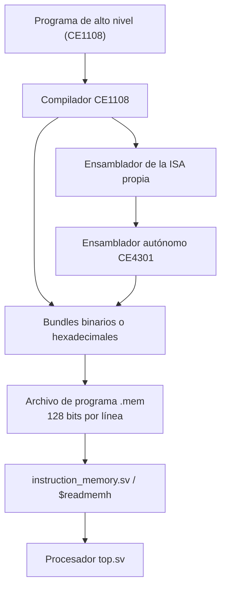

# Integración con Compiladores (CE1108) — Contrato ISA–generador de código

**Curso:** CE-4301 Arquitectura de Computadores I  
**Proyecto:** Proyecto Grupal I — Arquitectura VLIW propia para cifrado por bloques Feistel4  
**Documento:** `docs/compiler-integration.md`  
.

## 1. Propósito y alcance

El proyecto se desarrolla en coordinación con un grupo de **Compiladores e Intérpretes (CE1108)**. El objetivo de esta integración es que un programa producido por el compilador de CE1108 pueda convertirse en **bundles VLIW binarios** y ejecutarse directamente sobre el procesador SystemVerilog implementado en CE4301.

Según la especificación oficial del proyecto, la integración requiere:

1. Entregar a CE1108 un contrato estable con las instrucciones, sus codificaciones binarias, la distribución de slots, las convenciones de registros y la sintaxis del ensamblador propio.
2. Permitir que CE1108 genere **binario directamente** o produzca **ensamblador de la ISA propia** que posteriormente procese el ensamblador de CE4301.
3. Mantener un **ensamblador autónomo de CE4301**, capaz de ejercitar la totalidad de la ISA sin depender del compilador de CE1108.
4. Proporcionar un modelo de simulación o un procedimiento reproducible para ejecutar el código emitido.
5. Demostrar, antes de la defensa, la ejecución correcta de **al menos un programa generado por el compilador de CE1108** en el procesador VLIW propio.


Documentación relacionada:

- [`isa.md`](isa.md): hoja de referencia de instrucciones y codificación binaria detallada.
- [`microarchitecture.md`](microarchitecture.md): pipeline, interconexiones y control.
- [`simulation.md`](simulation.md): pruebas, formato de memoria y ejecución con Icarus Verilog.

## 2. Responsabilidades de los equipos

| Equipo | Responsabilidades de integración |
| --- | --- |
| **CE4301 — Arquitectura** | Especificar la ISA efectiva; suministrar codificaciones y convenciones; implementar y mantener el procesador SystemVerilog; proporcionar el ensamblador propio y la interfaz de simulación; validar el comportamiento del código generado. |
| **CE1108 — Compiladores** | Traducir desde el lenguaje de alto nivel; seleccionar las instrucciones disponibles; asignarlas a los slots; calendarizar dependencias y saltos; insertar NOP cuando corresponda; producir binario ejecutable directamente o mediante el ensamblador acordado. |
| **Ambos equipos** | Fijar y comunicar el contrato de entrada/salida; sincronizar cambios de ISA; escoger programas de prueba; compartir trazas y resultados; registrar evidencia de una ejecución conjunta reproducible. |

La **calendarización estática** pertenece al generador de código. El procesador no determina dinámicamente qué instrucciones son independientes ni reorganiza su ejecución.

## 3. Contrato de bundle y memoria de instrucciones

### 3.1. Formato binario

Cada bundle contiene **128 bits (16 bytes)**, divididos en cuatro slots **fijos de 32 bits**:

```text
  127             96 95              64 63              32 31               0
  +-----------------+-------------------+-------------------+-------------------+
  | FEIST (slot 3)  | BRU (slot 2)      | LSU (slot 1)      | ALU (slot 0)      |
  +-----------------+-------------------+-------------------+-------------------+
        32 bits           32 bits             32 bits             32 bits
```

El ensamblador o compilador debe colocar cada operación **únicamente en el slot de su unidad funcional**. Las posiciones no utilizadas se rellenan con `NOP` (`0x00000000` en los 32 bits de ese slot).

| Slot | Bits del bundle | Unidad funcional | Opcode local |
| --- | --- | --- | --- |
| 0 | `[31:0]` | ALU | `[3:0]` de su slot (4 bits) |
| 1 | `[63:32]` | LSU | `[1:0]` de su slot (2 bits) |
| 2 | `[95:64]` | BRU | `[2:0]` de su slot (3 bits) |
| 3 | `[127:96]` | FEIST | `[2:0]` de su slot (3 bits) |

**Regla obligatoria de codificación:** todos los **bits sobrantes/reservados** que no pertenecen a campos definidos de una instrucción deben codificarse como **cero**. La regla aplica también cuando la unidad no hace una verificación explícita de tales bits; no deben utilizarse para transmitir datos adicionales.

### 3.2. Archivo hexadecimal para `$readmemh`

`instruction_memory.sv` representa cada entrada como un bundle completo de 128 bits y carga el archivo mediante `$readmemh`. Por tanto, la salida hexadecimal prevista es **una línea por bundle**, con **32 dígitos hexadecimales por línea**:

```text
FEIST(8 hex) BRU(8 hex) LSU(8 hex) ALU(8 hex)
```

Los espacios de la línea anterior son **solo explicativos**; en el archivo `.mem` real se concatenan los 32 dígitos hexadecimales, sin separadores. Ejemplo con `ADD x4, x2, x3` solamente en ALU:

```text
00000000000000000000000000003241
```

Este ejemplo deja FEIST, BRU y LSU en NOP y coloca `0x00003241` en el slot ALU. El archivo no almacena texto ensamblador: almacena los valores de bundles ya codificados.

**No invertir el orden de los ocho dígitos por slot** al generar líneas para `$readmemh`. La representación hexadecimal de la palabra de 128 bits (`FEIST | BRU | LSU | ALU`) y el orden *little-endian* de los bytes en memoria son conceptos distintos.

### 3.3. PC y direcciones

- El PC corresponde a una **dirección en bytes**, no al índice de un bundle.
- En ejecución secuencial: `PC_siguiente = PC_actual + 16`.
- Cada bundle ocupa 16 bytes y debe comenzar en una dirección **alineada a 16** (`PC[3:0] = 0`).
- La memoria de instrucciones predeterminada es de **64 KiB**, es decir, hasta **4096 bundles**.
- Las direcciones no alineadas o fuera del rango admitido generan error en `instruction_memory` y el bundle de Fetch se marca inválido.
- La memoria de datos del modelo también tiene 64 KiB por defecto, direccionados por bytes, con accesos LOAD/STORE de palabras de 32 bits.

El programa debe ubicarse en las posiciones correspondientes al PC inicial efectivo (por defecto `RESET_PC = 0`). No se debe suponer un cambio automático de dirección inicial ni de formato de entrada.

## 4. Contrato de instrucciones y operandos

Los campos de cada instrucción son **locales a su slot de 32 bits**. En todos los formatos, los bits no indicados están reservados y valen cero.

### 4.1. ALU — Slot 0

| Tipo | Campos locales de bits | Instrucciones y opcode de 4 bits |
| --- | --- | --- |
| R | `rs2[15:12]`, `rs1[11:8]`, `rd[7:4]`, `opcode[3:0]` | `ADD 0001`, `SUB 0010`, `OR 0011`, `XOR 0100`, `AND 0101`, `SLT 0110` |
| I | `imm[23:12]`, `rs1[11:8]`, `rd[7:4]`, `opcode[3:0]` | `ADDI 1001`, `SRLI 1010`, `SLLI 1011` |
| NOP | Slot en cero | `0000` |

`ADDI` utiliza un inmediato de **12 bits con signo** (`-2048` a `2047`); `SLT` realiza comparación con signo. En los módulos actuales, `SRLI` y `SLLI` usan el valor **completo** de `imm[11:0]` como cantidad de desplazamiento; para desplazamientos útiles de palabras de 32 bits es recomendable emitir valores de `0` a `31`.

### 4.2. LSU — Slot 1

| Instrucción | Campos locales de bits | Opcode de 2 bits |
| --- | --- | --- |
| `LOAD rd, offset(rb)` | `offset[21:10]`, `rb[9:6]`, `rd[5:2]` | `01` |
| `STORE rs1, offset(rb)` | `offset[21:10]`, `rb[9:6]`, `rs1[5:2]` | `10` |
| `NOP` | Slot en cero | `00` |

`offset` tiene **12 bits con signo**, se extiende a 32 bits y se suma al contenido de `rb`. La memoria transfiere **cuatro bytes por operación**, con orden *little-endian*. La implementación de `data_memory` comprueba que el acceso no sobrepase el límite de memoria; no realiza una comprobación de alineación a 4 bytes. No existen instrucciones propias para cargar o guardar bytes individuales o medias palabras en la ISA compartida.

### 4.3. BRU — Slot 2

| Instrucción | Campos locales de bits | Opcode de 3 bits |
| --- | --- | --- |
| `JMP offset` | `offset[22:3]` (20 bits con signo) | `001` |
| `BGE rs1, rs2, offset` | `offset[22:11]`, `rs2[10:7]`, `rs1[6:3]` | `010` |
| `BLE rs1, rs2, offset` | Igual que BGE | `011` |
| `BEQ rs1, rs2, offset` | Igual que BGE | `100` |
| `BNE rs1, rs2, offset` | Igual que BGE | `101` |
| `NOP` | Slot en cero | `000` |

La BRU calcula el destino como **`PC_del_bundle + offset_extendido_con_signo`** cuando el salto se toma. Esto es distinto de calcularlo a partir de `PC + 16`: el desplazamiento es relativo a la dirección del **bundle que contiene el salto**. Los offsets expresan **bytes**, no cantidades de instrucciones. Los saltos condicionales comparan los registros indicados; `BGE` y `BLE` interpretan sus valores como enteros con signo.

Como Fetch exige direcciones de bundle alineadas a 16 bytes, el generador debe producir **destinos alineados**. Por ejemplo, si un `JMP` está en `PC = 0x00000020` y debe saltar al bundle en `0x00000060`, el offset codificado es `0x40` (64 bytes), **no** `4` bundles ni `0x30` desde el siguiente PC.

### 4.4. FEIST — Slot 3

| Instrucción | Campos locales de bits | Opcode de 3 bits |
| --- | --- | --- |
| `AUTH rs1, rs2` | `rs1[6:3]`, `rs2[10:7]` | `001` |
| `LOGOUT` | Sin operandos | `010` |
| `KSTORE key, round, rs1` | `rs1[6:3]`, `round[8:7]`, `key[10:9]` | `011` |
| `FROUND rdL, rdR, rsL, rsR, key, round, mode` | `rdL[23:20]`, `rdR[19:16]`, `rsL[15:12]`, `rsR[11:8]`, `key[7:6]`, `round[5:4]`, `mode[3]` | `100` |
| `NOP` | Slot en cero | `000` |

Los índices `key` y `round` tienen **2 bits**, con valores `0` a `3`. `mode = 0` significa cifrado y `mode = 1` descifrado. Cada `FROUND` ejecuta **una ronda** sobre un bloque de 64 bits dividido en las mitades de 32 bits `L` y `R`; la llave de 128 bits se administra como cuatro subllaves de 32 bits.

La bóveda de llaves es **privilegiada y no mapeada a la memoria de datos**. La secuencia válida requiere autorización (`AUTH`), escritura autorizada de las subllaves (`KSTORE`) y uso de la llave **desde la bóveda** (`FROUND`), nunca desde un registro general como fuente de subllave durante el cifrado. `LOGOUT` elimina la autorización. El módulo `key_vault` del material usa credenciales constantes **provisionales para simulación**: estas no constituyen un mecanismo de seguridad para producción.

La función de ronda que debe verificarse contra la referencia del profesor es:

```text
F(x, k) = ((ROL32(x, 5) + k) mod 2^32) XOR ROL32(x, 13)

Cifrado (mode=0):     L' = R              R' = L XOR F(R, k)
Descifrado (mode=1):  L' = R XOR F(L, k); R' = L
```

La línea de descifrado se expresa de forma precisa como: **`L' = R XOR F(L, k)` y `R' = L`**. Para cifrar se emplean las rondas `0 → 1 → 2 → 3`; para descifrar se emplean en orden `3 → 2 → 1 → 0`.

## 5. Contrato de registros

| Registro | Lectura y escritura | Restricción del generador de código |
| --- | --- | --- |
| `x0` | Devuelve siempre cero; se descartan escrituras. | Utilizarlo como fuente cero o destino descartable. |
| `x1` | Lectura especial: PC del bundle actual. Escrituras válidas provenientes de ALU o LOAD redirigen el PC. | **No usar como temporal general**; los destinos de las redirecciones deben estar alineados a 16 bytes. |
| `x2`–`x15` | Registros generales de 32 bits. | Mantener las convenciones de uso que acuerden ambos equipos. |

`FROUND` tiene **dos registros destino**. En `top.sv` se bloquea su escritura a `x1`; por ello `rdL` y `rdR` deben escogerse fuera de `x1` cuando el resultado deba conservarse. También deben evitarse destinos coincidentes entre instrucciones del mismo bundle: aunque el banco dispone de varios puertos de escritura, el compilador no debe depender de un resultado implícito cuando dos puertos escriben el mismo registro en el mismo flanco.


## 6. Calendarización estática y dependencias

### 6.1. Pipeline que observa el compilador

`top.sv` implementa cinco etapas:

```text
IF (fetch) → ID (decode/dispatch) → RR (register read) → EX (execute) → WB (writeback)
```

Los resultados ALU, LOAD y FROUND pasan por `EX/WB` y se escriben en el banco de registros en **WB**. Las instrucciones posteriores leen operandos en **RR**. No se incluye *forwarding*, *scoreboarding*, reordenamiento automático ni inserción de stalls por dependencias de datos.

Por consiguiente, el generador debe resolver tanto las **dependencias dentro del bundle** como las **dependencias entre bundles consecutivos**.

### 6.2. Reglas de empaquetado

- Un bundle puede contener **como máximo una operación de cada slot fijo**: una ALU, una LSU, una BRU y una FEIST.
- Las operaciones empaquetadas en el **mismo bundle** deben poder leer sus fuentes sin depender de un resultado que otra operación del propio bundle vaya a escribir después.
- No agrupar escrituras que compitan por el **mismo registro destino**, ni dos mecanismos simultáneos de redirección del PC que generen resultados ambiguos.
- Completar con `0x00000000` todos los slots no utilizados.
- Preservar dependencias de memoria y de estado (por ejemplo, `STORE` seguido de `LOAD`, o `AUTH`/`KSTORE` antes de `FROUND`) además de las dependencias entre registros.
- No usar `stall_i` como sustituto de la calendarización: es una entrada de control del procesador, no un detector dinámico de dependencias implementado.

### 6.3. Separación de una dependencia RAW

**Regla conservadora para esta implementación de cinco etapas:** si el bundle `B0` produce en un registro general un resultado por ALU/LOAD/FROUND, el primer bundle que lo consume debe empezar **no antes de `B3`** cuando el procesador avanza a razón de un bundle por ciclo y sin *forwarding*. Es decir, deben existir **dos bundles intermedios** (`B1` y `B2`) con operaciones independientes o NOP.

La razón es que `B0` alcanza WB durante el mismo ciclo en que `B2` estaría leyendo sus fuentes en RR; con escrituras en flanco positivo no es seguro asumir que `B2` observa el resultado nuevo. `B3` realiza RR después de ese flanco.

| Bundle | Ciclo 1 | Ciclo 2 | Ciclo 3 | Ciclo 4 | Ciclo 5 | Ciclo 6 | Ciclo 7 | Ciclo 8 |
| --- | --- | --- | --- | --- | --- | --- | --- | --- |
| `B0`: productor | IF | ID | RR | EX | WB | — | — | — |
| `B1`: independiente | — | IF | ID | RR | EX | WB | — | — |
| `B2`: independiente | — | — | IF | ID | RR | EX | WB | — |
| `B3`: consumidor | — | — | — | IF | ID | RR | EX | WB |

**Interpretación:** el productor alcanza WB en el ciclo 5 y el consumidor seguro alcanza RR en el ciclo 6. Los bundles intermedios pueden llevar instrucciones independientes; solo hacen falta NOP si no hay trabajo útil disponible. Esta regla se deriva del flujo mostrado en `top.sv` y debe verificarse en el programa final de integración; no constituye un subsistema automático de gestión de riesgos.

**Ejemplo conceptual de calendarización** (no representa necesariamente la sintaxis aceptada por el ensamblador aún no aportado):

```text
B0: ALU = ADDI x4, x0, 7    | LSU = NOP | BRU = NOP | FEIST = NOP
B1: ALU = NOP               | LSU = NOP | BRU = NOP | FEIST = NOP
B2: ALU = NOP               | LSU = NOP | BRU = NOP | FEIST = NOP
B3: ALU = ADD  x5, x4, x4   | LSU = NOP | BRU = NOP | FEIST = NOP
```

### 6.4. Dependencias de autenticación y llaves

Las instrucciones de bóveda cambian el estado interno en un flanco de reloj de **EX**, mientras FROUND consulta ese estado. A diferencia de un resultado escrito a un registro general en WB, no hay una dependencia RAW de registro entre el estado de la bóveda y FROUND. Sin embargo, el compilador debe preservar **el orden lógico** de `AUTH → KSTORE → FROUND`, garantizar que las subllaves se almacenaron antes del uso y que `LOGOUT` no invalide prematuramente la operación.

Si las credenciales o subllaves provienen de cálculos ALU/LOAD previos, **sí** les aplica la separación entre productor de registro y consumidor FEIST en RR descrita arriba. Se debe verificar la secuencia concreta con el testbench integrado.

## 7. Cambios de flujo y saltos

El salto se evalúa en EX. Si se toma, `pipeline_control.sv` redirige el PC y activa `flush` para descartar bundles más jóvenes que ya estaban en IF/ID/RR. **No se utiliza un branch delay slot arquitectónico**: el mecanismo implementado es el vaciado explícito de las instrucciones posteriores en el pipeline.

Reglas para el generador:

1. Codificar el offset desde el **PC del bundle que contiene la BRU**.
2. Comprobar que el destino final esté alineado a **16 bytes** y dentro de la memoria de instrucciones disponible.
3. No depender de efectos de bundles posteriores al salto cuando este se toma, pues pueden ser invalidados.
4. Tener presente que otros slots **del mismo bundle del salto** pueden ejecutar sus operaciones, ya que comparten la etapa EX; no interpretarlos automáticamente como instrucciones anuladas por el salto.
5. Considerar que una escritura a `x1` desde ALU o LOAD se resuelve en **WB**, redirige el PC y tiene prioridad de control sobre un salto BRU tomado en EX. Es preferible no mezclar redirecciones que puedan interferirse.

Si el compilador realiza optimizaciones, no debe mover operaciones con efectos sobre memoria, bóveda o control más allá de un salto sin demostrar que la reordenación conserva el comportamiento del programa.

## 8. Interfaz de generación de código

La especificación oficial permite dos rutas:




anexar aquí un ejemplo reproducible de:

- Fuente en ensamblador de CE4301.
- Archivo `.mem` que produce el ensamblador.
- Comando exacto para generarlo.
- Comando o destino de Makefile para simularlo.
- Resultado esperado y resultado observado.

La **capacidad de codificación de toda la ISA** por parte del ensamblador debe verificarse por separado y **no** se considera demostrada solo por disponer de decodificadores SystemVerilog.

## 9. Plan de validación conjunta y evidencia

El objetivo mínimo de integración de CE1108 es demostrar **al menos un programa realmente generado por su compilador** y ejecutado con resultados correctos sobre el procesador propio. Se dan dos niveles de validación:

### 9.1. Compatibilidad binaria mínima

Comprobar un programa con ALU, LOAD/STORE y salto que permita verificar:

- Distribución correcta de cada operación en su slot.
- Posiciones de los campos y opcodes.
- Bits reservados en cero y NOP canónicos.
- Incremento del PC de 16 en 16 y cálculo correcto de offsets.
- Separación de dependencias y escrituras en WB.
- Transferencia de palabras y orden de bytes en memoria de datos.

### 9.2. Programa conjunto con Feistel4

Preparar un caso que permita observar, de principio a fin:

1. Carga/preparación de los operandos del bloque de 64 bits (`L`, `R`) y del material de llave para `KSTORE`.
2. Instrucción `AUTH` que habilite el acceso a la bóveda de prueba.
3. Escritura autorizada de las **cuatro subllaves** de una de las cuatro llaves disponibles.
4. Cuatro llamadas a `FROUND` de cifrado, con rondas `0, 1, 2, 3`.
5. Cuatro llamadas a `FROUND` de descifrado, con rondas `3, 2, 1, 0`.
6. Comparación del valor cifrado con la implementación de referencia Feistel4 del enunciado y del valor descifrado con el bloque original.
7. Comprobación de que la calendarización evita lecturas prematuras de operandos y de que las llaves no salen a registros generales.
8. Uso de operaciones generales y criptográficas en los mismos bundles, cuando sean independientes, para demostrar coexistencia de las unidades.


### 9.3. Registro sugerido de evidencia

registrar:

| Evidencia | Qué se debe guardar | Estado constatado con los archivos facilitados |
| --- | --- | --- |
| Contrato enviado a CE1108 | Fecha, versión de `isa.md`, destinatarios y confirmación | **Sin constancia aportada** |
| Ensamblador propio | Código fuente, comandos y cobertura de instrucciones | **No incluido en el material de módulos** |
| Archivo generado por CE1108 | Fuente de alto nivel, salida ensamblador/binaria y versión de compilador | **No aportado** |
| Compilación del procesador | Comando ejecutado y salida completa | **Makefile disponible; ejecución no reproducida en esta revisión** |
| Ejecución conjunta | Log de simulación y, de ser posible, VCD | **Sin evidencia de programa proveniente de CE1108** |
| Resultado criptográfico | Bloque original, cifrado esperado/obtenido, descifrado recuperado | **Existen testbenches de cifrado; la ejecución conjunta con CE1108 no está demostrada** |
| Herramienta de archivos | Comandos de carga/extracción y comparación del archivo final | **No identificada en el documento de módulos** |


### 9.4. Protocolo reproducible para cerrar la validación

Cuando CE1108 entregue un programa, completar este procedimiento en el repositorio:

1. Registrar el commit o la versión del compilador, del ensamblador y del procesador.
2. Conservar el archivo fuente de alto nivel y su salida intermedia, si existe.
3. Generar el binario hexadecimal de 128 bits por bundle e inspeccionar al menos un bundle mixto.
4. Ejecutar la simulación indicando la ruta real de `PROGRAM_FILE` y el comando exacto.
5. Capturar la salida de consola y el archivo VCD correspondiente.
6. Comparar los resultados obtenidos con la implementación de referencia del enunciado.
7. Documentar el resultado de cada paso e identificar las correcciones necesarias si alguno falla.

**Plantilla para completar tras la ejecución:**

```text
Fecha de la prueba:              PENDIENTE
Versión/commit de CE1108:        PENDIENTE
Versión/commit de CE4301:        PENDIENTE
Programa fuente:                 PENDIENTE
Archivo de bundles generado:     PENDIENTE
Comando de generación:           PENDIENTE
Comando de simulación:           PENDIENTE
Resultado esperado:              PENDIENTE
Resultado obtenido:              PENDIENTE
Evidencia (log/VCD):             PENDIENTE
Conclusión de la prueba:         PENDIENTE
```

