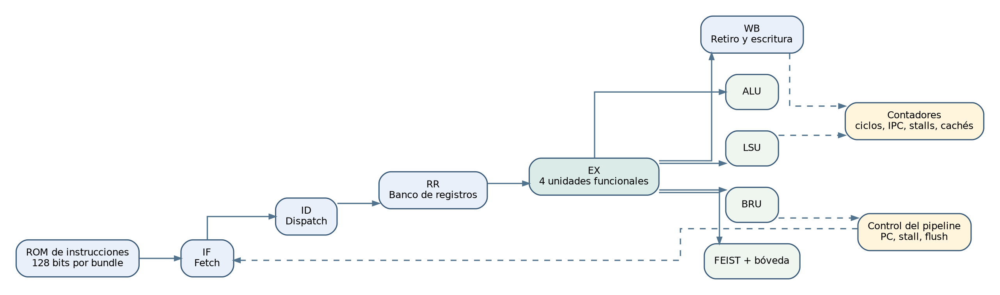
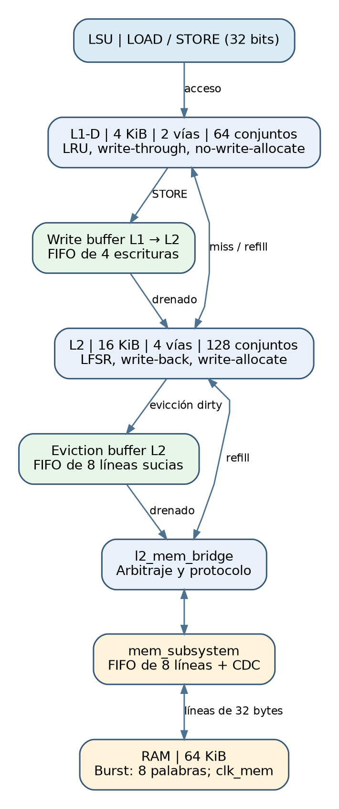
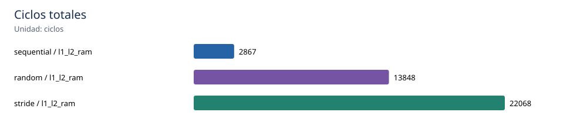
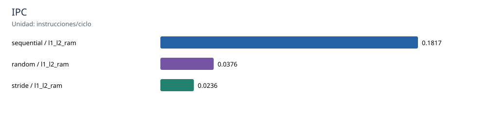
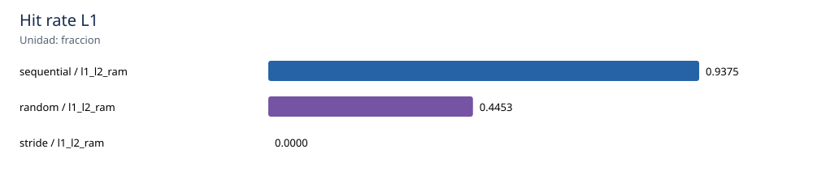
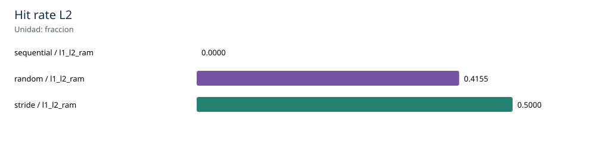
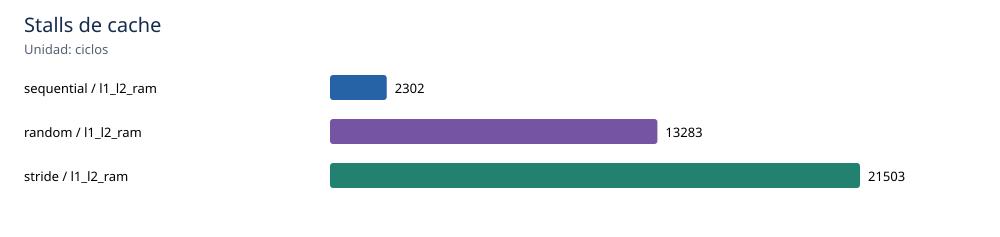
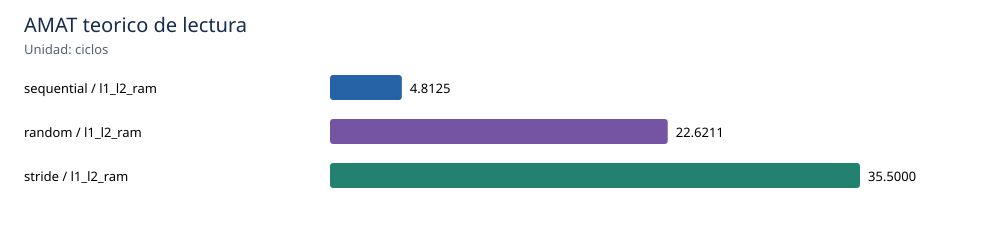

# Resumen

Este proyecto extiende el procesador VLIW propio de cuatro slots y 128 bits, desarrollado en Arquitectura de Computadores I (CE4301), con una jerarquía de memoria de datos de dos niveles, buffers de escritura y contadores de rendimiento. La implementación se realizó en SystemVerilog y se integró con una memoria principal simulada en otro dominio de reloj. Se mantuvo la ISA del procesador original, incluidas las unidades ALU, LSU, BRU y FEIST, mientras que las instrucciones de acceso a datos se conectaron a L1-D, L2 y RAM.

La validación comprende pruebas unitarias de cachés, controladores, buffers y pipeline; simulaciones de integración; y tres benchmarks de acceso secuencial, aleatorio y con salto (*stride*). El conjunto de evidencias incluido en el repositorio registra **2 867, 13 848 y 22 068 ciclos**, respectivamente, para **521 instrucciones retiradas** en cada programa. El análisis demuestra la relación entre localidad de referencias, tasas de acierto, ciclos de espera e IPC, sin atribuir estos resultados a configuraciones que no aparecen medidas en el conjunto de datos.

# 1. Introducción y objetivos

Una memoria principal de mayor latencia que el procesador puede limitar el aprovechamiento de una arquitectura capaz de ejecutar varias operaciones por paquete. Las cachés almacenan temporalmente líneas de datos para atender las referencias frecuentes o cercanas sin recurrir siempre a RAM. Al mismo tiempo, las optimizaciones y la calendarización del compilador influyen en el orden de accesos y en las oportunidades de paralelismo que puede aprovechar un VLIW.

El objetivo del Proyecto II es extender la organización segmentada del procesador VLIW del Proyecto I mediante una jerarquía de caché L1-D/L2, integrar sus esperas con el pipeline y medir el efecto de los patrones de acceso sobre el rendimiento. De manera específica, el diseño busca:

1. Mantener el formato y la codificación binaria de las instrucciones VLIW originales.
2. Incorporar L1-D de 4 KiB y L2 de 16 KiB, con políticas de escritura y reemplazo documentadas.
3. Incorporar un *write buffer* hacia L2 y un *eviction buffer* para líneas modificadas.
4. Simular transferencias de líneas completas hacia una RAM de 64 KiB en un dominio de reloj más lento.
5. Congelar el bundle completo ante accesos que no puedan completarse inmediatamente y medir ciclos, instrucciones, aciertos, fallos y esperas.
6. Ejecutar programas representativos, incluida una prueba de integración con el compilador de CE1108.

# 2. Ambiente y organización del desarrollo

El procesador está descrito en **SystemVerilog**. El repositorio utiliza **Icarus Verilog** (`iverilog` y `vvp`) para compilar y simular, **GNU Make** para tareas de elaboración y ejecución, **Python 3** para el ensamblador, la preparación de benchmarks y el análisis de métricas, y scripts **Bash** para orquestar las pruebas. Las formas de onda VCD pueden visualizarse con **GTKWave**. El entorno de trabajo contempla Linux o Ubuntu bajo WSL.

La organización relevante de archivos es la siguiente:

| Ruta | Responsabilidad |
|:---|:---|
| `src/top.sv` | Conecta el procesador, las memorias, el control de espera y los contadores. |
| `src/pipeline/` | Fetch, dispatch, registros de etapas y control del pipeline. |
| `src/functional-units/` | ALU, LSU, BRU, unidad criptográfica y bóveda de llaves. |
| `src/memory/` | ROM, L1-D, L2, buffers, puente y controlador de RAM. |
| `src/performance_counters.sv` | Contadores de rendimiento del procesador y del subsistema de memoria. |
| `tb/` | Testbenches funcionales, de integración y de benchmarks. |
| `python/` | Ensamblador, generadores, carga/extracción y análisis. |
| `scripts/` | Automatización de simulaciones de L2 y de benchmarks. |
| `docs/evidencias_rendimiento/` | CSV y gráficos de los tres benchmarks de hardware. |

# 3. Arquitectura VLIW

## 3.1. Organización del bundle y unidades funcionales

El procesador conserva bundles de **128 bits**, compuestos por cuatro slots fijos de **32 bits**. Su distribución es:

| Bits del bundle | Slot | Unidad | Funciones principales |
|:---|:---:|:---|:---|
| `[31:0]` | 0 | ALU | Aritmética, lógica, inmediatos y desplazamientos. |
| `[63:32]` | 1 | LSU | LOAD y STORE de palabras de 32 bits. |
| `[95:64]` | 2 | BRU | Saltos y control de flujo. |
| `[127:96]` | 3 | FEIST | Autenticación, bóveda de llaves y rondas Feistel4. |

Un slot sin operación contiene un NOP codificado con ceros. El contador de programa usa direcciones en bytes y avanza **16 bytes** por bundle secuencial. El banco de registros posee 16 registros de 32 bits; `x0` representa la constante cero y `x1` tiene semántica especial asociada al PC. La especificación detallada de opcodes y campos se conserva en [`isa.md`](isa.md).

La ISA del Proyecto I no se modifica para agregar caché. Su integración se hace en la microarquitectura, sin nuevos opcodes de control de caché.

## 3.2. Pipeline y ejecución

La organización implementada contiene cinco etapas: **IF, ID, RR, EX y WB**. IF lee el bundle de ROM; ID separa y decodifica los slots; RR obtiene los operandos; EX ejecuta operaciones en paralelo y conecta la LSU con L1-D; y WB completa las escrituras y el retiro. No se incorporó una etapa MEM independiente: la latencia de acceso a datos se absorbe mediante la detención de las etapas cuando la LSU necesita esperar.

{ width=94% }

La calendarización permanece **estática**. El hardware no reordena instrucciones ni resuelve dependencias entre bundles mediante *scoreboarding* o *forwarding* general. La herramienta que genera el programa debe respetar RAW, WAR y WAW, insertar NOP cuando sea necesario y asegurar que los saltos utilicen direcciones compatibles con el formato de bundle.

## 3.3. Detenciones, saltos y retiro

La señal `cache_resp_stall`, procedente de `l1_data_system`, se integra en `top.sv` mediante `global_stall = stall_i | cache_stall`. Durante una espera de datos se detiene el avance del pipeline, incluidos PC y registros de etapas; por tratarse de un VLIW, **la espera afecta al bundle completo**, no únicamente al slot LSU. Los saltos de BRU y la escritura especial al PC pueden generar *flush* de las operaciones más jóvenes.

`performance_counters.sv` mide ciclos totales, bundles completados e instrucciones no-NOP retiradas. El retiro se cuenta desde una etapa válida de WB, sin duplicarlo durante un stall. Las operaciones STORE y BRU también cuentan cuando ocupan un slot válido, aunque no escriban el banco de registros general.

# 4. Jerarquía de memoria

## 4.1. Configuración

| Característica | L1-D | L2 |
|:---|:---|:---|
| Capacidad | 4 KiB | 16 KiB |
| Asociatividad | 2 vías | 4 vías |
| Conjuntos | 64 | 128 |
| Línea de caché | 32 bytes | 32 bytes |
| Reemplazo | LRU con 1 bit por conjunto | Vía inválida primero; después elección pseudoaleatoria LFSR |
| Política de escritura | Write-through | Write-back con bit dirty |
| Miss de STORE | No-write-allocate | Write-allocate |
| Tiempo de hit | 1 ciclo (objetivo L1) | 8 ciclos en respuesta de lectura del controlador |
| Buffer asociado | FIFO de 4 escrituras | FIFO de 8 líneas sucias |

Las direcciones son de 32 bits. En L1 se utilizan el desplazamiento `[4:0]`, el índice de conjunto `[10:5]` y el tag `[31:11]`. En L2 se utiliza el mismo desplazamiento, índice `[11:5]` y tag `[31:12]`. Cada línea contiene ocho palabras de 32 bits.

{ width=55% }

## 4.2. Lectura y reposición

Una instrucción LOAD solicita una palabra alineada a cuatro bytes. Ante un acierto en L1, la palabra se entrega localmente. Si L1 falla, `l1_miss_controller` solicita a L2 la línea de 256 bits y el pipeline espera. L2 consulta sus conjuntos y vías y, si tampoco encuentra la línea, solicita el bloque a RAM. Al recibirlo, L2 instala la línea, responde hacia L1 y esta completa el LOAD original. El conteo de misses corresponde a solicitudes originales, no a la nueva consulta del dato inmediatamente después del refill.

En un reemplazo de L2, el controlador selecciona una vía y conserva la dirección y los datos de la víctima durante la operación. Si la línea desalojada está marcada como dirty, se deposita en el *eviction buffer* antes de reutilizar la vía.

## 4.3. Escrituras y coherencia de datos

**L1-D utiliza write-through y no-write-allocate.** Cada STORE aceptado se incorpora a `l1_write_buffer`, FIFO de cuatro entradas de dirección y palabra. Si la línea estaba en L1, su valor se actualiza localmente; si no estaba, no se inicia un refill solo por la escritura. El FIFO envía los STORE a L2 y puede detener nuevas escrituras cuando alcanza su capacidad.

**L2 utiliza write-back y write-allocate.** Un STORE que falla en L2 provoca la obtención de la línea, seguida de la actualización de la palabra y el marcado de dirty. En los reemplazos, el buffer de L2 conserva líneas sucias completas de 256 bits. `mem_subsystem` contiene además una FIFO de líneas hacia RAM, separada del buffer interno de L2, y sincroniza las transacciones entre `clk_i` y `clk_mem_i`.

Para evitar un riesgo RAW en memoria, la estrategia implementada es **stall**: L1 espera a que su FIFO no tenga escrituras pendientes antes de permitir un LOAD, y L2/memoria esperan cuando una lectura tiene conflicto con una línea todavía en proceso de desalojo. No se utiliza *store-to-load forwarding* desde los buffers.

## 4.4. Política de inclusión

La relación seleccionada es **NINE** (*not inclusive, not exclusive*). No se impone que todos los bloques residentes en L1 estén también en L2, ni se exige que sean mutuamente excluyentes. El diseño no implementa invalidación hacia atrás cuando L2 reemplaza una línea. La decisión simplifica el control en un procesador de un único núcleo, para el cual no se requiere mantener coherencia entre cachés privadas de diferentes procesadores. La consistencia de datos se protege mediante el orden de las transacciones, los bits de validez/suciedad y las esperas RAW.

## 4.5. Memoria principal, ráfagas y dominios de reloj

`mem_controller.sv` implementa **64 KiB** de memoria direccionable por byte y transfiere líneas de 32 bytes mediante ráfagas de ocho palabras. Los benchmarks utilizan CPU a **100 MHz** y RAM a **25 MHz** (periodos de 10 ns y 40 ns); `mem_subsystem.sv` incorpora sincronizadores de dos flip-flops para el intercambio de solicitudes y confirmaciones entre dominios.

El requisito de análisis de la especificación define una latencia nominal de primera palabra de 25 ciclos de CPU y siete ciclos de memoria adicionales. Para 25 MHz:

\[
T_{mem,nominal}=25+7\left\lceil\frac{100}{25}\right\rceil=53\;\text{ciclos de CPU}.
\]

En el RTL, `MEM_FIRST_LAT` tiene valor por defecto **3** y se expresa en ciclos de `clk_mem`; su latencia física observada incluye también arbitraje y sincronización de dominios. Por tanto, el valor nominal de 53 ciclos empleado para estimar AMAT se distingue de la duración real de las solicitudes observadas en simulación.

## 4.6. Vaciado de escrituras al finalizar

El subsistema incluye un mecanismo de *flush* para recorrer L2 y enviar sus líneas dirty hacia el buffer de desalojo. La señal `flush_done_o` de `top.sv` se condiciona tanto al final del recorrido de L2 como al vaciado del buffer hacia RAM y al retorno del subsistema de memoria a estado inactivo. Esto permite distinguir la corrección de datos todavía residentes en caché de su persistencia en RAM cuando el programa termina.

# 5. Contadores y metodología de evaluación

## 5.1. Instrumentación

Los contadores de CPU registran ciclos, bundles retirados, instrucciones no-NOP, stalls de caché y de saltos. Se desglosan además las esperas asociadas a consulta L2, acceso a memoria y buffers. L1 cuenta hits/misses de lectura y escritura; el controlador de L2 expone los cuatro conteos equivalentes. RAM informa solicitudes de lectura/escritura aceptadas, ciclos ocupados y palabras transferidas.

Las fases parciales de stall **son subconjuntos** del stall total de caché y no deben sumarse dos veces. Los aciertos de L2 se dividen entre las solicitudes que efectivamente llegan a L2, no entre los LOAD totales del procesador. Si no existen accesos de un tipo, su tasa se considera no definida.

## 5.2. Métricas

\[
IPC=\frac{N_{\mathrm{instrucciones\ retiradas}}}{N_{\mathrm{ciclos}}}
\]

\[
Hit\ Rate_{L1}=\frac{Hits_{L1}}{Hits_{L1}+Misses_{L1}},\qquad
Hit\ Rate_{L2}=\frac{Hits_{L2}}{Hits_{L2}+Misses_{L2}}
\]

\[
AMAT_{lectura,modelo}=1+MR_{L1}\left(8+MR_{L2}\,T_{mem,nominal}\right)
\]

La fórmula de AMAT corresponde a una **estimación teórica de lectura** basada en las tasas locales, tiempos nominales y jerarquía completa. No representa la medición directa del retardo de cada LOAD ni incluye las demoras adicionales por contención. El analizador también calcula el ancho de banda a partir de las palabras transferidas en la ventana de ciclos de CPU.

## 5.3. Diseño de los benchmarks

El generador `python/generate_benchmarks.py` construye tres programas representativos. Cada programa realiza **dos pasadas de 256 LOAD**, para un total de **512 lecturas**, y se valida comparando diez registros de salida con los valores esperados. Usa una semilla seudoaleatoria fija (`2026`) y datos deterministas. Los tres ejecutan **521 instrucciones no-NOP** en el registro de hardware.

| Programa | Patrón | Intención |
|:---|:---|:---|
| `sequential` | Palabras contiguas | Observar localidad espacial y reutilización de líneas. |
| `random` | Selección seudoaleatoria fija entre 2 048 palabras | Dispersar referencias y aumentar misses. |
| `stride` | Incrementos de 32 bytes | Cambiar de línea en cada lectura y ejercer presión sobre L1/L2. |

El testbench `tb_benchmarks_hw.sv` simula CPU, L1, L2 y RAM. `scripts/run_hardware_benchmarks.sh` genera instrucciones, compila cada prueba, ejecuta `vvp`, comprueba los registros y consolida `hardware.csv` con el estado `PASS`. La evaluación mantiene la misma configuración (`l1_l2_ram`) y el mismo criterio de terminación para los tres programas.

# 6. Resultados experimentales

## 6.1. Rendimiento del procesador

Los valores de las tablas provienen del archivo versionado [`evidencias_rendimiento/hardware.csv`](evidencias_rendimiento/hardware.csv). Las tres filas fueron procesadas por `python/analyze_performance.py`, que genera métricas derivadas y los gráficos correspondientes.

| Indicador | Secuencial | Aleatorio | Stride |
|:---|---:|---:|---:|
| Ciclos totales | 2 867 | 13 848 | 22 068 |
| Bundles retirados | 560 | 560 | 560 |
| Instrucciones retiradas | 521 | 521 | 521 |
| IPC | 0,1817 | 0,0376 | 0,0236 |
| Stalls de caché (ciclos) | 2 302 | 13 283 | 21 503 |
| Stalls de saltos (ciclos) | 0 | 0 | 0 |
| Hits L1 de lectura | 480 | 228 | 0 |
| Misses L1 de lectura | 32 | 284 | 512 |
| Hit rate L1 de lectura | 93,75 % | 44,53 % | 0,00 % |
| Hits L2 de lectura | 0 | 118 | 256 |
| Misses L2 de lectura | 32 | 166 | 256 |
| Hit rate L2 de lectura | 0,00 % | 41,55 % | 50,00 % |
| Lecturas de línea desde RAM | 32 | 166 | 256 |
| Palabras transferidas desde RAM | 256 | 1 328 | 2 048 |
| AMAT teórico (ciclos) | 4,8125 | 22,6211 | 35,5000 |

{ width=91% }

{ width=91% }

## 6.2. Análisis de la localidad

En el patrón **secuencial**, 480 de las 512 lecturas se resolvieron en L1; los 32 misses corresponden a las líneas distintas consultadas. Es el programa con mayor IPC y menor tiempo de ejecución dentro del conjunto medido. El 0 % de hit en L2 no indica por sí solo una mala configuración de L2: las líneas reutilizadas permanecieron en L1, de modo que los accesos hacia el nivel inferior fueron predominantemente compulsorios.

El patrón **aleatorio** produjo 284 misses en L1 y 166 lecturas desde RAM. Su tiempo total fue mayor por la menor localidad de las referencias. En **stride**, las 512 lecturas fallaron en L1, mientras L2 atendió 256 de esas solicitudes; la otra mitad requirió RAM. Por ello se registraron 22 068 ciclos, la menor tasa de IPC y el mayor número de palabras recuperadas de memoria entre las tres pruebas.

En comparación con el programa secuencial, el programa aleatorio empleó aproximadamente **4,83 veces** la cantidad de ciclos; stride empleó **7,70 veces**. Esta razón compara **patrones distintos sobre una misma jerarquía** y no es una aceleración atribuible a una optimización del compilador.

{ width=87% }

{ width=87% }

## 6.3. Esperas y memoria

La cantidad de stalls de caché aumenta desde 2 302 ciclos en secuencial hasta 21 503 ciclos en stride. Los contadores de memoria informan 1 726, 8 761 y 13 567 ciclos ocupados, respectivamente. La tasa local de L2 debe interpretarse junto con el número de solicitudes: en stride la tasa de hit de L2 es mayor que en aleatorio, pero sus 512 misses de L1 obligan a consultar L2 mucho más frecuentemente.

{ width=91% }

{ width=91% }

## 6.4. Alcance experimental

El CSV contiene **una configuración física de caché** y tres patrones de lectura. Las columnas de escritura L1/L2 y de escritura física a RAM permanecen en cero para estos benchmarks. Por lo tanto, sus resultados permiten evaluar localidad, IPC, misses, tráfico de lectura y espera, pero **no cuantifican** en forma aislada el beneficio frente a una arquitectura sin caché ni el efecto de habilitar/deshabilitar cada optimización de CE1108. La funcionalidad de escritura, reemplazo y RAW se aborda mediante pruebas específicas de módulos y de integración.

# 7. Validación funcional e integración con el compilador

## 7.1. Pruebas dirigidas de subsistemas

La batería `scripts/run_l2_tests.sh` contempla controladores L2, cache L2, buffer de desalojo, selección de víctimas, backpressure, espera RAW, latencia y funcionamiento L1/L2. El repositorio contiene además testbenches dedicados a L1, *write buffer*, control de misses, control de pipeline, stalls de LOAD/STORE, unidad FEIST, contadores y señales de salto. El objetivo de estas pruebas es aislar errores de protocolo y de estado que no se distinguen con claridad en los benchmarks de lectura.

Se incluyen pruebas de integración como `tb_metricas.sv`, `tb_pipeline_performance_integration.sv` y `tb_matriz.sv`; las dos primeras ejercitan contadores y retiro, mientras la tercera ejecuta un programa generado por Compiladores e Intérpretes sobre el procesador completo.

## 7.2. Programa de matriz

El repositorio contiene `pruebas-compilador/matriz.mem` y `tb/tb_matriz.sv`. El testbench interpreta como terminación el salto del programa a su propio PC y verifica 100 elementos de matrices 10×10. La documentación de la ejecución incluida en el repositorio reporta los siguientes resultados:

| Comprobación | Valor reportado |
|:---|:---|
| Ciclos de ejecución | 539 896 |
| PC del salto final | `0x0000FAD0` |
| Tamaño de la matriz | 10 × 10 |
| `resultado[0][0]` | 21 |
| Indicador `errores` | 0 |
| Indicador `prueba_correcta` | 1 |
| Verificación de los elementos | PASS |

La lectura de verificación busca el valor vigente en L1, L2 o RAM, según dónde resida la línea. Este criterio resulta apropiado para un diseño con L2 write-back y escrituras que pueden permanecer temporalmente en la jerarquía antes de su vaciado final.

## 7.3. Contrato ISA–Compilador

El compilador del curso CE1108 debe producir paquetes compatibles con los cuatro slots de 32 bits, conservar las codificaciones y generar direcciones de salto alineadas al tamaño de bundle. La calendarización estática de dependencias, los NOP y los registros de propósito especial se describen en [`compiler-integration.md`](compiler-integration.md). La compatibilidad se valida mediante ejecución de código de máquina en el RTL y comprobación de resultados, no solo por la aceptación sintáctica del ensamblador.

# 8. Reproducción de simulaciones

Las instrucciones siguientes se ejecutan desde la raíz del repositorio en Linux/WSL.

```bash
sudo apt update
sudo apt install -y iverilog make python3
```

**Elaboración del diseño completo:**

```bash
make check
make top
```

**Pruebas de L2 e integración L1/L2:**

```bash
bash scripts/run_l2_tests.sh
```

**Generación y simulación de los tres benchmarks:**

```bash
bash scripts/run_hardware_benchmarks.sh
```

**Reprocesamiento de las evidencias CSV incluidas en el repositorio:**

```bash
python3 python/analyze_performance.py \
  --hardware docs/evidencias_rendimiento/hardware.csv \
  --out build/analisis-evidencia
```

**Prueba de integración del programa matriz:**

```bash
mkdir -p build
mapfile -t RTL < <(sed -n '/^SRC =/,/^$/p' Makefile | grep -oE 'src/[^[:space:]\\]+\.sv')
iverilog -g2012 -Wall -s tb_matriz -o build/tb_matriz.vvp \
  tb/tb_matriz.sv "${RTL[@]}"
vvp build/tb_matriz.vvp
```

**Ejecución de un programa ensamblado:**

```bash
python3 python/assembler.py prueba_cifrado.asm -o build/programa_ejemplo.mem
make run PROGRAM=build/programa_ejemplo.mem DATA=input.mem
```

Los archivos de salida de los benchmarks se generan bajo `build/benchmarks/`, incluidos logs, CSV, reportes y gráficas. `make check` y `make top` son los objetivos del Makefile destinados a verificar la elaboración de la integración actual. Los procedimientos especializados anteriores utilizan las rutas reales de `src/pipeline/` y `src/memory/`.

# 9. Decisiones de diseño y discusión

La combinación de **L1 write-through** y **L2 write-back** facilita mantener datos de la CPU coherentes con el nivel siguiente mientras reduce el número de transferencias de líneas completas a RAM. Los buffers amortiguan la llegada de escrituras, pero requieren control cuando están llenos o existe una dependencia RAW. La estrategia de espera elegida sacrifica parte del paralelismo de memoria a cambio de un protocolo más simple y verificable.

La **inclusión NINE** evita implementar invalidaciones hacia atrás de L2 a L1; es una elección apropiada para estudiar desempeño de un solo núcleo sin la complejidad de coherencia multiprocesador. La política LRU de L1 favorece la retención de líneas recientemente utilizadas, mientras el LFSR de L2 simplifica la selección de reemplazo sin mantener un orden exacto de uso para sus cuatro vías.

La separación de **reloj CPU** y **reloj de memoria** permite observar el efecto de una RAM más lenta. En este contexto, se distinguen la penalidad teórica utilizada por el modelo de AMAT y los tiempos reales del controlador de memoria y los sincronizadores. Finalmente, la instrumentación de métricas incorporada en hardware evita deducir las tasas de hit únicamente a partir de las direcciones previstas por el benchmark.

# 10. Conclusiones

1. Se integró en el RTL una jerarquía de datos L1-D/L2/RAM compatible con el formato VLIW previo, sin cambiar el contrato de instrucciones entre Arquitectura y Compiladores.
2. Los módulos incorporan dos políticas de escritura complementarias, buffers FIFO, control de dirty bits y detenciones por dependencias RAW; el pipeline recibe la detención como un control global de bundle.
3. Las mediciones guardadas muestran una relación directa entre localidad y rendimiento. El benchmark secuencial alcanzó 93,75 % de hits de lectura en L1 y 0,1817 instrucciones/ciclo; stride tuvo 0 % de hits L1 y 0,0236 instrucciones/ciclo.
4. Los contadores permiten separar el retiro de instrucciones, las esperas por caché, los accesos L1/L2 y las transferencias hacia RAM, brindando información reproducible para comparar programas sobre la misma arquitectura.
5. El programa de matriz permite comprobar la ejecución de un binario generado por CE1108 sobre el procesador completo y verificar el resultado en la jerarquía de memoria.

# 11. Referencias

1. González Gómez, J. *Arquitectura de Computadores I (CE4301): notas de clase*. Instituto Tecnológico de Costa Rica, versión del 13 de agosto de 2026.
2. González Gómez, J., y Leitón Jiménez, J. *Especificación Proyecto Grupal II: Análisis de Impacto de Memoria Caché y Optimizaciones de Compilador en la Organización de Procesador Propio tipo VLIW*. Instituto Tecnológico de Costa Rica, II semestre de 2026.
3. Repositorio de Arquitectura, *Arquitectura1-IIS2026*: `src/`, `tb/`, `scripts/`, `python/` y `docs/evidencias_rendimiento/`. https://github.com/FabiMC040105/Arquitectura1-IIS2026
4. Repositorio de Compiladores, *CompiladoresIIS2026*: documentación de integración ISA–Compilador. https://github.com/FabiMC040105/CompiladoresIIS2026

