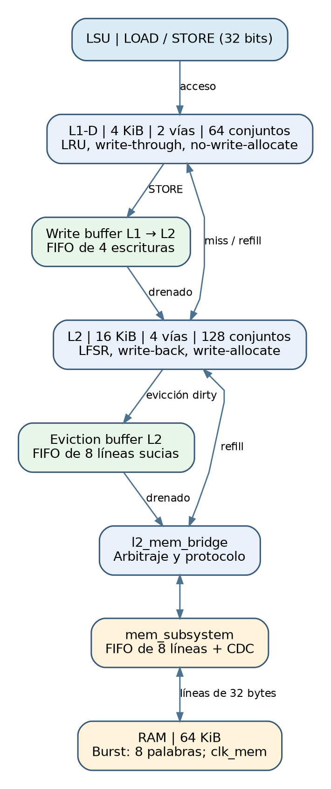

# Diseño de la jerarquía L1-D, L2 y memoria principal

## Parámetros y políticas

| Elemento | L1-D | L2 |
|:---|:---|:---|
| Tamaño | 4 KiB | 16 KiB |
| Asociatividad | 2 vías / 64 conjuntos | 4 vías / 128 conjuntos |
| Línea | 32 bytes / 8 palabras | 32 bytes / 8 palabras |
| Índice y tag | `[10:5]` y `[31:11]` | `[11:5]` y `[31:12]` |
| Reemplazo | LRU, 1 bit por conjunto | Vía inválida o selección LFSR |
| Escritura | Write-through | Write-back, dirty bit |
| Asignación en STORE miss | No-write-allocate | Write-allocate |
| Buffer | FIFO de 4 escrituras de palabra | FIFO de 8 líneas sucias |

## Flujo de lectura

1. LSU emite LOAD de palabra alineada.
2. `cache_l1.sv` compara el tag dentro del conjunto de dos vías. En hit entrega una palabra de 32 bits.
3. En miss, `l1_miss_controller.sv` solicita una línea completa a L2 y congela el bundle mediante `cpu_stall`.
4. `l2_controller.sv` consulta L2; un hit de lectura se responde con latencia controlada de ocho ciclos CPU.
5. Ante miss L2, se reserva una vía, se envía la línea dirty a FIFO si procede y se solicita la línea a la RAM por `l2_mem_bridge.sv`.
6. L2 y L1 instalan la línea y se completa el LOAD original sin contar el refill como un segundo acceso de CPU.

## Flujo de escritura

En L1, cada STORE aceptado se encola en `l1_write_buffer.sv`. Una línea que ya reside en L1 puede actualizarse, pero un miss de escritura no origina refill. L2 recibe la palabra y, si no encuentra la línea, efectúa write-allocate: obtiene el bloque, modifica una palabra y marca la línea dirty. Cuando una víctima de L2 está sucia, se introduce en `l2_eviction_buffer.sv`, capaz de almacenar ocho líneas completas.

El subsistema incorpora **dos buffers de líneas distintos**: el de L2 para sus víctimas dirty y el FIFO del `mem_subsystem`, configurado en `top.sv` con profundidad ocho para el drenado hacia la RAM. El puente `l2_mem_bridge.sv` adapta lecturas y escrituras de líneas entre L2 y el subsistema de memoria.

## Política de inclusión y dependencias

Se utiliza **NINE** (no inclusiva, no exclusiva). No se exige presencia simultánea de una línea en L1 y L2, ni se incluye invalidación hacia atrás al reemplazar una línea de L2. La selección reduce complejidad para un procesador mononúcleo.

El riesgo de lectura después de escritura pendiente (**RAW**) se controla mediante **stall**, no con reenvío directo desde buffer. L1 requiere que las escrituras en FIFO hayan sido drenadas antes de iniciar el LOAD; en L2 y la memoria se bloquean lecturas que entrarían en conflicto con líneas sucias todavía pendientes de desalojo. Si algún FIFO está lleno, el productor espera a que se libere capacidad.

## RAM y sincronización temporal

`mem_controller.sv` modela 64 KiB, orden little-endian, y ráfagas de ocho palabras de 32 bits. El reloj de CPU es 100 MHz y el de memoria es 25 MHz en los benchmarks. La especificación define una latencia nominal total de 53 ciclos CPU con esta frecuencia, pero el parámetro de RTL `FIRST_LAT=3` se expresa en ciclos de memoria; el tiempo efectivo de extremo a extremo incluye sincronización y arbitraje.

El diseño dispone de `flush_i` para recorrer las líneas dirty de L2. `flush_done_o` se activa una vez que concluye el recorrido y las escrituras pendientes han salido de los buffers hacia RAM.

## Justificación de las decisiones

L1 write-through evita gestionar dirty bits en el primer nivel; su FIFO amortigua las escrituras frecuentes, mientras L2 write-back reduce transferencias completas a RAM. La política LRU en dos vías requiere muy poco estado; la selección LFSR en L2 evita un LRU exacto de cuatro vías. NINE elimina invalidación inversa y es suficiente como política de inclusión de un único núcleo. El tratamiento de RAW mediante stall favorece la sencillez y la consistencia funcional frente a una solución no bloqueante más compleja.
