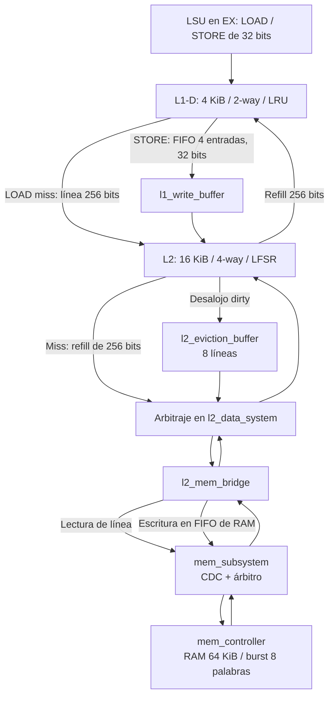

# Arquitectura de la jerarquía L1-D / L2 / memoria principal

**Proyecto II — CE4301.** Este documento sustituye la descripción preliminar de una integración L1/L2 aislada: `src/top.sv` ya instancia los dos niveles, el puente y `mem_subsystem` junto al pipeline.

## 1. Configuración de cachés

| Propiedad | Caché L1-D | Caché L2 |
| --- | --- | --- |
| Capacidad | 4 KiB | 16 KiB |
| Asociatividad | 2 vías | 4 vías |
| Conjuntos | 64 | 128 |
| Línea | 32 bytes (256 bits, 8 palabras) | 32 bytes (256 bits, 8 palabras) |
| Bits dirección (32 bits) | tag `[31:11]`, set `[10:5]`, offset `[4:0]` | tag `[31:12]`, set `[11:5]`, offset `[4:0]` |
| Reemplazo | LRU de 1 bit por conjunto | Primer espacio inválido; después pseudoaleatorio con LFSR |
| Escritura | Write-through | Write-back con dirty bit |
| Miss de STORE | No-write-allocate | Write-allocate |
| Hit de lectura | Camino local L1 | Controlador `l2_controller`: 8 ciclos desde handshake hasta respuesta |
| Archivo | `cache_l1.sv` | `cache_l2.sv` |

Las dos cachés operan sobre direcciones de 32 bits y líneas alineadas a 32 bytes. El LSU acepta palabras alineadas a cuatro bytes. L1 no necesita dirty bits porque los STORE aceptados se envían al buffer de escritura; L2 sí necesita dirty bits para desalojar únicamente líneas modificadas.

## 2. Diagrama de la jerarquía

**Dos FIFOs de desalojo:** existe una FIFO de ocho líneas en `l2_data_system` y otra FIFO en `mem_subsystem` con profundidad configurable `MEM_EV_DEPTH=8`. Su ubicación y función no deben confundirse: la primera protege los desalojos internos de L2 y la segunda desacopla la interfaz de escritura hacia el controlador RAM.

## 3. Lecturas y refill

1. La LSU entrega dirección y señal de LOAD. L1 comprueba tag y vía del conjunto.
2. En hit, L1 selecciona una palabra de 32 bits y retorna `cpu_ready`.
3. En miss, `l1_miss_controller` solicita a L2 una línea alineada; mientras espera se emite `cpu_stall` y el pipeline se congela.
4. Si L2 acierta, entrega la línea tras la espera del controlador. Si falla, elige víctima; la escribe a FIFO si es sucia, solicita a RAM el bloque y lo instala.
5. La línea vuelve a L1, que la rellena y atiende la palabra solicitada. El contador de L1 registra el miss original una sola vez, sin contabilizar el refill como un hit nuevo.

## 4. Escrituras, buffers y RAW

**L1: write-through + no-write-allocate.** `l1_data_system.sv` puede actualizar la palabra local en hit, pero cada STORE aceptado se encola en la FIFO de cuatro entradas (`l1_write_buffer.sv`). Si ocurre un miss de STORE, no se trae una línea a L1; la escritura continúa hacia L2. Una FIFO llena causa backpressure hasta liberar una entrada. Para asegurar la lectura de datos actualizados, L1 exige que el buffer esté vacío antes de iniciar un LOAD: **estrategia stall, no store-to-load forwarding**.

**L2: write-back + write-allocate.** Cuando una escritura llega a L2 y la línea no está presente, `l2_controller` la trae, modifica la palabra y marca dirty la línea. Ante reemplazo de una víctima dirty, los 256 bits se insertan en `l2_eviction_buffer` (o se espera capacidad si está lleno). La FIFO detecta conflictos RAW por dirección de línea: antes de leer un bloque aún pendiente de desalojo, `l2_data_system` retrasa la solicitud hasta terminar la escritura relevante. El `mem_subsystem` también aplica espera ante coincidencias con su FIFO de desalojos.

**Trade-off:** las esperas RAW reducen la complejidad frente a hacer forwarding desde FIFO, aunque pueden aumentar los stalls. Las FIFOs disminuyen el bloqueo directo por escritura pero no garantizan que toda operación sea no bloqueante.

## 5. Inclusión y coherencia

La política implementada es **NINE (no inclusiva, no exclusiva)**. Un bloque puede estar en L1 y L2 simultáneamente o solamente en uno de los niveles según accesos y reemplazos. No existe un mecanismo que obligue a invalidar L1 cuando L2 sustituye una vía. Por ello **no se debe describir la arquitectura como inclusiva**; para sostener esa propiedad haría falta invalidación hacia atrás.

No hay multiprocesamiento ni coherencia entre núcleos. La corrección relevante se refiere a cargas y escrituras del único procesador, sus FIFOs y desalojos; la estrategia de prevención de RAW se basa en stall.

## 6. Memoria principal y latencia

`mem_controller.sv` modela 64 KiB direccionables por byte, en little-endian y transferencias de líneas completas de 32 bytes. Los testbenches de rendimiento usan `clk_i = 100 MHz` y `clk_mem_i = 25 MHz`. La primera palabra se transfiere tras `FIRST_LAT` ciclos **de memoria** y cada una de las siete palabras restantes ocupa otro ciclo de memoria. El parámetro por defecto de `top` es `MEM_FIRST_LAT=3`.

El enunciado define una latencia objetivo de **25 ciclos de CPU hasta la primera palabra** y, con 25 MHz, `Tmem = 25 + 7×4 = 53` ciclos de CPU. `python/analyze_performance.py` utiliza esa **fórmula teórica** en su AMAT, mientras que el RTL controla la primera palabra mediante `MEM_FIRST_LAT` más los tiempos de arbitraje y sincronización. No debe afirmarse equivalencia exacta sin una prueba dirigida que mida desde la emisión hasta la primera palabra.

## 7. Validación disponible

- `bash scripts/run_l2_tests.sh` compila nueve testbenches para hit/miss, L2, FIFO, sustitución, RAW, latencia y L1/L2.
- `bash scripts/run_hardware_benchmarks.sh` ejercita el procesador completo con tres patrones de lectura y contadores reales.
- `tb/tb_metricas.sv`, `tb/tb_pipeline_performance_integration.sv` y `tb/tb_matriz.sv` comprueban integración de métricas, congelamiento/retiro y programa matriz, respectivamente.

El contenido de estos testbenches permite saber qué se pretende verificar; solo se debe anotar **PASS ejecutado** tras correr la simulación local y conservar su salida. La documentación actual incluye resultados CSV previamente guardados, no una nueva corrida de Icarus.
