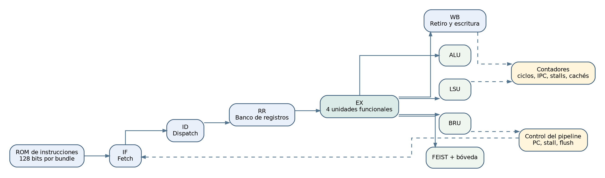

# Organización y microarquitectura del procesador

## Diseño general

La implementación conserva la ISA del procesador VLIW propio. Cada bundle tiene **128 bits** y cuatro slots fijos: ALU `[31:0]`, LSU `[63:32]`, BRU `[95:64]` y FEIST `[127:96]`. Los slots vacíos contienen NOP codificado con ceros y el PC avanza 16 bytes por bundle. El banco de registros maneja `x0` a `x15`, de 32 bits; `x0` es cero y `x1` se interpreta como referencia especial al PC en el datapath.



## Etapas del pipeline

| Etapa | Función | Módulos |
|:---|:---|:---|
| IF | Obtiene bundles desde ROM. | `fetch.sv`, `instruction_memory.sv` |
| ID | Separa los slots y decodifica sus campos. | `dispatch.sv`, decodificadores funcionales |
| RR | Lee operandos y resuelve las convenciones de registros. | `register_file.sv`, `top.sv` |
| EX | Ejecuta ALU, BRU, FEIST y accesos LSU a caché. | `functional-units/*.sv`, `l1_data_system.sv` |
| WB | Escribe resultados, completa bundles y registra retiro. | `top.sv`, `performance_counters.sv` |

El diseño no añade una etapa MEM independiente. La LSU solicita una palabra de 32 bits a L1; si el acceso no puede atenderse, el control de caché produce `cache_resp_stall`. En `top.sv` se forma `global_stall = stall_i | cache_stall`, que detiene el avance del **bundle completo**, incluidos el PC y los registros de segmentación. Los saltos de BRU y la redirección mediante PC especial generan señales de vaciado (*flush*) para no completar operaciones inválidas.

No se incorporó detección dinámica de dependencias entre bundles ni forwarding/scoreboarding general. La calendarización es responsabilidad del código generado, que debe respetar dependencias RAW, WAR y WAW e insertar NOP cuando corresponda.

## Integración de la jerarquía de datos

El camino de memoria implementado es:

```text
LSU → l1_data_system → l2_data_system → l2_mem_bridge
    → mem_subsystem → mem_controller (RAM)
```

`top.sv` recibe dos relojes, `clk_i` y `clk_mem_i`. `mem_subsystem.sv` utiliza sincronizadores de dos etapas definidos en `flop_sync.sv` para coordinar las transacciones entre ambos dominios. La ROM de instrucciones se mantiene separada del sistema de cachés de datos.

Los parámetros del módulo principal incluyen `IMEM_WORDS=16384`, `MEM_EV_DEPTH=8` y `MEM_FIRST_LAT=3`, además de las rutas de programa y datos. Los testbenches de rendimiento usan periodos de 10 ns y 40 ns, equivalentes a 100 MHz y 25 MHz.

## Contadores de rendimiento

`performance_counters.sv` contabiliza ciclos de CPU, bundles retirados, instrucciones no-NOP, stalls de caché y saltos, subdivisiones de espera, hits/misses L1 y transferencias de memoria. Los hits/misses L2 se toman del controlador `l2_controller.sv` y se exponen por `top.sv`. El evento de retiro corresponde a un bundle válido en WB sin stall; STORE y BRU cuentan como instrucciones si ocupan slots no-NOP.

La clasificación de esperas separa consulta L2, espera de RAM y bloqueo por buffers. Esas categorías son subconjuntos del stall total de caché; no se suman nuevamente al total. Los contadores permiten comparar trazas de ejecución equivalentes con un denominador común de ciclos CPU.

## Unidades y seguridad

Las unidades ALU, LSU y BRU procesan aritmética, memoria y control de flujo. El slot FEIST dispone de `crypto_unit.sv` y `key_vault.sv` para operaciones AUTH, KSTORE, FROUND y LOGOUT. El esquema Feistel4 y su ISA se mantienen desde el Proyecto I y se usan con fines académicos, no como una solución criptográfica de producción.

La organización y los resultados del Proyecto II se detallan en [el informe final](informe-final-proyecto2.md).
