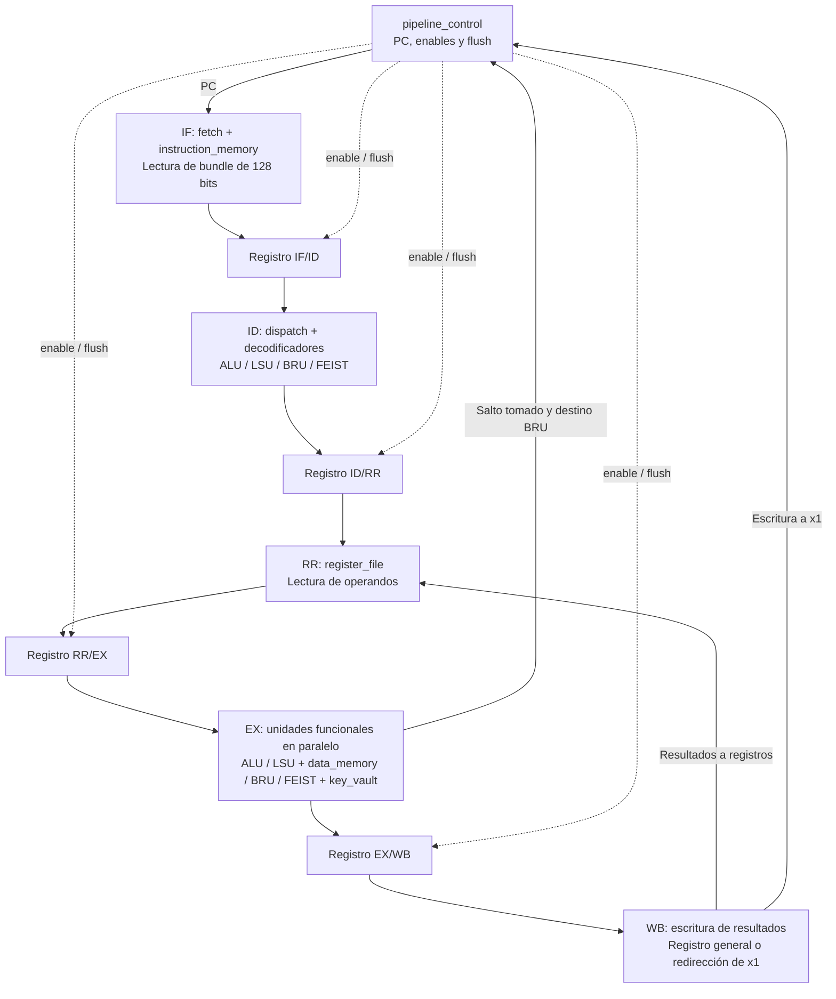
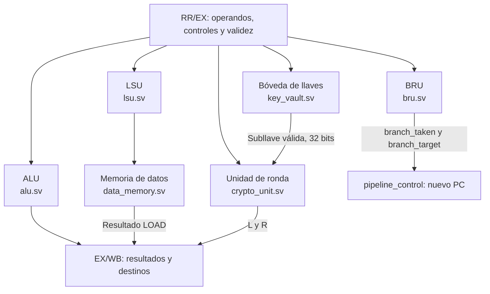

# Microarquitectura del procesador VLIW Feistel4

**Curso:** CE-4301 Arquitectura de Computadores I  
**Proyecto:** Proyecto Grupal I — Arquitectura VLIW propia para cifrado por bloques  


## 1. Organización general

El procesador implementa una arquitectura **VLIW (*Very Long Instruction Word*)** de cuatro *slots* fijos y un pipeline de **cinco etapas: IF, ID, RR, EX y WB**. Cada *bundle* contiene 128 bits, organizados en cuatro instrucciones de 32 bits que se destinan a unidades funcionales distintas. El procesamiento de los *slots* ocurre en paralelo dentro de la etapa EX, según las operaciones activas y válidas del *bundle*.

| Parámetro | Valor del diseño |
| --- | --- |
| Ancho de *bundle* | 128 bits (16 bytes) |
| Slots | 4, de 32 bits cada uno |
| Slot 0 | ALU (aritmética y lógica) |
| Slot 1 | LSU (carga y almacenamiento) |
| Slot 2 | BRU (saltos) |
| Slot 3 | FEIST (autenticación, bóveda y Feistel4) |
| Registros arquitectónicos | `x0` a `x15`, de 32 bits; `x0` es cero y `x1` representa al PC |
| Direccionamiento | 32 bits |
| Memoria de instrucciones predeterminada | 64 KiB, organizados como 4096 *bundles* de 128 bits |
| Memoria de datos predeterminada | 64 KiB, direccionable por byte |
| Pipeline | IF → ID → RR → EX → WB |

La filosofía VLIW empleada es de **calendarización estática**. Las instrucciones colocadas en un mismo *bundle* y en *bundles* consecutivos deben respetar las dependencias entre operandos, destinos y control de flujo. El hardware **no incorpora forwarding, scoreboarding ni detección dinámica de riesgos de datos**. La inserción de NOP y la planificación de operaciones son responsabilidad del ensamblador, del compilador o del programador.

## 2. Diagrama de bloques

El siguiente diagrama representa el recorrido principal de un *bundle* y los enlaces de realimentación del control de flujo. Los bloques `IF/ID`, `ID/RR`, `RR/EX` y `EX/WB` son instancias del módulo parametrizable `pipeline_reg`.



### 2.1. Organización de la etapa de ejecución

Los *slots* no se intercambian entre unidades. `dispatch` separa las cuatro palabras de 32 bits y los decodificadores correspondientes extraen los campos de control. Los operandos llegan desde la etapa RR mediante `RR/EX`.



La BRU no escribe un resultado ordinario al banco de registros; si el salto se toma, produce una redirección del PC. Las instrucciones de bóveda que cambian autenticación o llaves actúan sobre `key_vault`, y **FROUND** entrega sus dos resultados de datos hacia WB.

## 3. Etapas del pipeline

| Etapa | Módulos principales | Función |
| --- | --- | --- |
| **IF** (*Instruction Fetch*) | `pipeline_control`, `fetch`, `instruction_memory` | Utiliza el PC para leer un *bundle* completo desde memoria de instrucciones. |
| **ID** (*Decode/Dispatch*) | `dispatch`, `alu_decoder`, `lsu_decoder`, `bru_decoder`, `feist_decoder` | Separa los cuatro *slots*, identifica NOP, extrae operandos y genera señales de control. |
| **RR** (*Register Read*) | `register_file` y multiplexores de `top` | Lee registros fuente y sustituye las lecturas de `x1` por el PC del *bundle*. |
| **EX** (*Execute*) | `alu`, `lsu`, `data_memory`, `bru`, `crypto_unit`, `key_vault` | Ejecuta las operaciones de los *slots* en paralelo; realiza accesos a datos y resuelve los saltos. |
| **WB** (*Writeback*) | `register_file` y lógica de escritura de `top` | Escribe los resultados de ALU, LOAD y FROUND; una escritura válida a `x1` desde ALU/LOAD redirige el PC. |

### 3.1. IF — Búsqueda de instrucciones

El PC de 32 bits se conserva en `pipeline_control`, no en el módulo `fetch`. En la secuencia normal se actualiza como:

```text
PC_siguiente = PC_actual + 16
```

El incremento es de **16 bytes** porque cada *bundle* ocupa 128 bits. `fetch` pasa la dirección del PC a `instruction_memory`. Esta memoria contiene palabras de 128 bits, carga el programa mediante `$readmemh(PROGRAM_FILE, memory)` y entrega el *bundle* correspondiente.

- La memoria de instrucciones verifica que la dirección esté **alineada a 16 bytes** (`addr[3:0] == 0`) y que el *bundle* completo se encuentre dentro del rango configurado.
- En un acceso inválido se activa `access_error`; `fetch` presenta entonces `valid_o = 0`.
- La memoria se inicializa en cero antes de cargar el programa. Por tanto, una palabra de 128 bits con todos sus *slots* NOP puede seguir siendo un *bundle* válido.
- La dirección se interpreta en bytes y se convierte en índice de *bundle* mediante `addr >> 4`.

### 3.2. ID — Separación y decodificación

`dispatch` recibe el *bundle* registrado en `IF/ID` y lo separa según las posiciones fijas:

| Bits del *bundle* | Slot | Salida de `dispatch` |
| --- | --- | --- |
| `[31:0]` | ALU | `instr_alu_o` |
| `[63:32]` | LSU | `instr_lsu_o` |
| `[95:64]` | BRU | `instr_bru_o` |
| `[127:96]` | FEIST | `instr_feist_o` |

`dispatch` no ejecuta ni interpreta completamente los operandos. Determina la validez de cada *slot* comparando su campo de opcode con cero: 4 bits en ALU, 2 bits en LSU y 3 bits en BRU y FEIST. Posteriormente, los cuatro decodificadores específicos extraen índices de registros, inmediatos, offsets y señales de operación. Los **bits reservados no utilizados deben codificarse como cero**, de acuerdo con las reglas del ISA.

El PC asociado al *bundle* también avanza por el pipeline, de modo que las lecturas de `x1` y el cálculo de destinos de salto puedan utilizar la dirección correspondiente a esa instrucción y no necesariamente el PC actual de Fetch.

### 3.3. RR — Lectura de registros

El banco `register_file` tiene 16 posiciones de 32 bits y se instancia con **8 puertos de lectura combinacional** y **4 puertos de escritura síncrona**. La distribución de lecturas en `top` es:

| Puertos de lectura | Consumidor | Uso |
| --- | --- | --- |
| 0 y 1 | ALU | Dos operandos fuente (`rs1`, `rs2`). |
| 2 y 3 | LSU | Registro base y dato para STORE. |
| 4 y 5 | BRU | Dos operandos de comparación. |
| 6 y 7 | FEIST | Compartidos entre AUTH, KSTORE y FROUND, según su operación. |

Los puertos 6 y 7 de FEIST se multiplexan porque un único *slot* FEIST codifica una sola de estas operaciones por *bundle*: AUTH lee dos credenciales; KSTORE lee el registro que contiene la subllave; FROUND lee las mitades izquierda y derecha del bloque.

`x0` devuelve siempre cero y se descartan las escrituras a ese índice. `x1` es un registro arquitectónico especial: **no almacena físicamente el PC en `register_file`**. Cuando una instrucción lee `x1`, la lógica de `top` entrega el **PC del propio *bundle*** que está en RR. Los registros `x2` a `x15` funcionan como registros de propósito general.

### 3.4. EX — Ejecución paralela

**ALU (`alu.sv`).** Es combinacional, con operaciones de suma, resta, OR, XOR, AND, comparación `SLT` con signo, suma con inmediato y desplazamientos lógicos. Produce `data_out` y una señal `zero`; la BRU compara sus propios operandos y no necesita utilizar el indicador `zero` para decidir un salto.

**LSU + memoria (`lsu.sv`, `data_memory.sv`).** La LSU extiende con signo un offset de 12 bits a 32 bits y calcula `effective_addr = base_addr + offset`. Genera las señales `mem_read`, `mem_write` y el dato de STORE. `data_memory` implementa 64 KiB predeterminados, direccionables por byte, con transferencias de **32 bits** en *little-endian*. La lectura es combinacional y la escritura de los cuatro bytes se realiza en el flanco positivo de reloj. Los accesos que no permiten leer/escribir los cuatro bytes dentro del rango generan `access_error`.

**BRU (`bru.sv`).** Ejecuta JMP, BGE, BLE, BEQ y BNE. Los saltos condicionales comparan directamente sus dos operandos (con signo para BGE y BLE). Si la condición se cumple, el destino es `PC_del_bundle + offset_extendido`; en caso contrario, no solicita redirección. `top` solo acepta un salto cuando tanto el *slot* BRU como el *bundle* están marcados como válidos.

**FEIST + bóveda (`crypto_unit.sv`, `key_vault.sv`).** `key_vault` modela cuatro llaves de 128 bits como una matriz de 4 × 4 subllaves de 32 bits. La instrucción AUTH compara credenciales y modifica `authorized`; LOGOUT elimina la autorización; KSTORE almacena una subllave si está autorizado. FROUND solicita una subllave al puerto interno de la bóveda y ejecuta una ronda de Feistel4 sobre dos mitades de 32 bits. Los resultados son `l_out` y `r_out`, destinados a dos registros generales en WB. La unidad reutiliza la misma función de ronda para cifrar o descifrar, cambiando el orden de las operaciones de Feistel. Para ejecutar cuatro rondas completas deben programarse cuatro FROUND con las subllaves en el orden correspondiente.

La bóveda: el valor `subkey_out` se conecta directamente a `crypto_unit` y solo es válido para una solicitud FROUND autorizada. Los valores almacenados en la bóveda se borran al aplicar `reset` en el módulo proporcionado. Las credenciales incluidas como constantes en `key_vault.sv` son de demostración y no representan una solución de autenticación segura para producción.

En `top`, los enables de lectura/escritura de memoria y de acceso a FEIST se filtran mediante la validez del *slot* y del *bundle* para evitar operaciones de *bundles* descartados. Los cambios de estado de la bóveda y las escrituras STORE se materializan en el flanco de reloj de la etapa EX, mientras que las salidas destinadas al banco de registros pasan por `EX/WB`.

### 3.5. WB — Escritura de resultados

`EX/WB` conserva los resultados, los índices destino y las señales de escritura. El banco de registros tiene cuatro puertos de escritura, distribuidos así:

| Puerto de escritura | Origen | Condición principal |
| --- | --- | --- |
| 0 | ALU | Resultado de un *slot* ALU válido; salvo redirección a `x1`. |
| 1 | LSU | Dato leído por LOAD válido y sin error de memoria; salvo redirección a `x1`. |
| 2 | FEIST | Resultado de la mitad izquierda de una FROUND autorizada; no se escribe `x1`. |
| 3 | FEIST | Resultado de la mitad derecha de una FROUND autorizada; no se escribe `x1`. |

Una operación STORE, BRU, AUTH, LOGOUT o KSTORE no necesita escribir un resultado ordinario al banco de registros. Si una operación de ALU o LOAD tiene como destino `x1`, `top` evita la escritura al banco y envía el valor al control del PC. El diseño da prioridad a la redirección procedente de ALU si **ambos slots ALU y LSU intentaran escribir `x1` en el mismo bundle**; los programas válidos deben evitar ese conflicto.

## 4. Registros entre etapas

Los cuatro registros se implementan mediante `pipeline_reg`, parametrizado por el ancho de los datos transportados. Cada uno conserva un campo de **validez** y tiene entradas `enable` y `flush`.

| Registro | Ancho definido en `top.sv` | Contenido principal |
| --- | ---: | --- |
| `IF/ID` | **160 bits** | Bundle de 128 bits + PC de 32 bits. |
| `ID/RR` | **167 bits** | PC, campos decodificados, registros fuente, inmediatos, controles y validez de slots. |
| `RR/EX` | **479 bits** | PC, operandos ya leídos del banco, destinos y controles para las cuatro unidades. |
| `EX/WB` | **179 bits** | PC, resultados ALU/LOAD/FROUND, registros destino y enables de escritura. |

Su funcionamiento secuencial sigue estas reglas:

1. `reset` asíncrono: pone el contenido en cero e invalida la etapa.
2. `flush`: pone el contenido en cero e invalida la etapa.
3. `enable = 1`: captura nuevos datos y su señal de validez en el flanco positivo.
4. `enable = 0`: mantiene los datos y la validez almacenados.

Al existir registros entre etapas, **diferentes bundles pueden estar simultáneamente en IF, ID, RR, EX y WB**, en lugar de esperar a que uno termine completamente antes de buscar el siguiente.

## 5. Control del pipeline y cambios de flujo

`pipeline_control.sv` mantiene el PC y gobierna los cuatro registros mediante señales `enable` y `flush`. La prioridad expresada por su lógica combinacional es:

| Prioridad | Condición | Comportamiento |
| ---: | --- | --- |
| 1 | `rst_i` | Reinicia el PC a `RESET_PC`; los registros de pipeline tienen su propio reset. |
| 2 | `stall_i` | Mantiene el PC y deshabilita la actualización de los cuatro registros. |
| 3 | Escritura válida a `x1` en WB | Actualiza el PC con el valor escrito e invalida `IF/ID`, `ID/RR`, `RR/EX` y `EX/WB`. |
| 4 | Salto BRU tomado en EX | Actualiza el PC con el destino e invalida los registros de los *bundles* más jóvenes: `IF/ID`, `ID/RR` y `RR/EX`. Permite que el *bundle* que está en EX pase a `EX/WB`. |
| Normal | Ninguna condición anterior | Avanza PC en 16 bytes y permite el avance de todos los registros. |

### 5.1. Tratamiento de saltos

El destino del salto se calcula en EX, por lo que ya puede haber *bundles* posteriores en etapas anteriores. Cuando `branch_taken_ex_i` es verdadero, el control emite un **flush explícito** de esos *bundles* más jóvenes y carga el nuevo PC. No se utiliza un predictor de saltos, reordenamiento dinámico ni forwarding automático. Un salto no tomado permite continuar la secuencia normal.

La redirección originada por una escritura a `x1` desde WB tiene prioridad sobre un salto detectado en EX. El generador de código debe considerar esta semántica al programar control de flujo. Como la memoria de instrucciones exige alineación a 16 bytes, los destinos válidos del PC deben quedar alineados.

### 5.2. Stalls y riesgos

El módulo de control admite una entrada global `stall_i`, que congela el PC y los registros entre etapas. 

## 6. Integración de módulos SystemVerilog

La instancia principal `top` conecta los módulos de datos y control de cada etapa:

| Módulo | Etapa o función | Responsabilidad en el diseño |
| --- | --- | --- |
| `top.sv` | Integración | Conecta pipeline, unidades, banco, memoria y señales de validez. |
| `pipeline_control.sv` | Control | Mantiene PC, salto/redirección, stall y flush. |
| `pipeline_reg.sv` | Registros | Almacena datos y validez entre etapas. |
| `fetch.sv` | IF | Interfaz de búsqueda de bundles. |
| `instruction_memory.sv` | IF | Almacena programa como bundles completos de 128 bits. |
| `dispatch.sv` | ID | Separa los slots y detecta NOP por opcode. |
| `alu_decoder.sv` | ID | Extrae opcode, modo inmediato, fuentes y destino de ALU. |
| `lsu_decoder.sv` | ID | Decodifica LOAD, STORE y controles de memoria. |
| `bru_decoder.sv` | ID | Decodifica comparaciones, JMP y offsets. |
| `feist_decoder.sv` | ID | Decodifica AUTH, LOGOUT, KSTORE y FROUND. |
| `register_file.sv` | RR/WB | Banco de registros con 8 lecturas y 4 escrituras. |
| `alu.sv` | EX | Operaciones aritméticas y lógicas. |
| `lsu.sv` | EX | Dirección efectiva y solicitudes de acceso a datos. |
| `data_memory.sv` | EX | Lecturas/escrituras de palabras de 32 bits. |
| `bru.sv` | EX | Evalúa saltos y determina el destino. |
| `crypto_unit.sv` | EX | Ejecuta una ronda de Feistel4. |
| `key_vault.sv` | EX, estado seguro | Autenticación, almacenamiento y entrega restringida de subllaves. |
| `bru_conexion.sv` | Apoyo | Integra decodificador BRU y BRU para pruebas; `top` instancia esos componentes directamente. |


