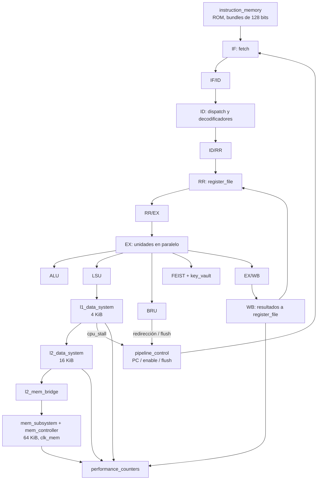

# Organización y microarquitectura del procesador VLIW extendido

**Proyecto II — CE4301.** Fuente principal: RTL actual en `src/top.sv`, `src/pipeline/`, `src/functional-units/` y `src/memory/`. El Proyecto II incorpora la jerarquía de datos al procesador del Proyecto I, sin modificar las instrucciones originales.

## 1. Organización general

El procesador maneja un bundle VLIW de **128 bits** por instrucción de memoria ROM. Cada bundle contiene cuatro slots fijos: ALU (bits 31:0), LSU (63:32), BRU (95:64) y FEIST (127:96). Las operaciones independientes pueden ocupar slots simultáneos; los vacíos se rellenan con NOP. El PC usa direcciones en bytes y avanza **16 bytes** en secuencia.

La microarquitectura mantiene cinco etapas: **IF → ID → RR → EX → WB**. Los registros de segmentación transportan el bundle, el PC y las señales de control. `pipeline_control.sv` gobierna PC, enables y flush. `register_file.sv` almacena 16 registros de 32 bits; `x0` se interpreta como cero y `x1` es una referencia especial al PC controlada desde `top.sv`.

## 2. Diagrama de bloques integrado

Las conexiones de memoria del diagrama representan transacciones de datos; la salida FEIST también afecta la bóveda de llaves. Los contadores no cambian la ISA.

## 3. Etapas y responsabilidades

| Etapa | Componente principal | Acción |
| --- | --- | --- |
| IF | `fetch`, `instruction_memory` | Lee un bundle completo desde ROM y verifica alineación/rango. |
| ID | `dispatch`, decodificadores | Separa y decodifica los slots. |
| RR | `register_file` | Lee operandos; mantiene las convenciones especiales `x0` y `x1`. |
| EX | ALU, LSU, BRU, FEIST, `key_vault` | Ejecuta operaciones y calcula direcciones LSU. La LSU utiliza la jerarquía L1/L2/RAM. |
| WB | Registro EX/WB y banco de registros | Completa resultados y contabiliza el retiro de slots no-NOP. |

**Nota de diseño:** no se añadió una etapa MEM independiente. Los accesos de LSU se realizan desde EX con espera mediante `cache_resp_stall`; es válido dentro de la alternativa prevista por el enunciado. El procesador no implementa forwarding ni scoreboarding entre bundles: la calendarización y los NOP corresponden al programa generado.

## 4. Stalls, saltos y validez

Las solicitudes de LOAD/STORE de LSU se conectan a `l1_data_system`. Una lectura que acierta en L1 puede completarse sin recorrer los niveles inferiores; un miss desencadena refill desde L2 y, si hace falta, RAM. `cache_stall` participa en el control global y congela el **bundle completo**, no un único slot. Durante la detención deben mantenerse PC y los registros de pipeline. Los saltos de BRU, y la escritura especial al PC, pueden invalidar operaciones especulativas mediante flush.

El conteo de retiro se hace en `performance_counters.sv`: un bundle válido que alcanza WB y no se encuentra congelado suma un bundle y hasta cuatro instrucciones según `retire_slots_i`. Un STORE o BRU también cuenta como instrucción aunque no escriba un registro general. El contador de ciclos sigue avanzando cuando hay stalls, durante la ventana de medición.

## 5. Integración memoria y dominios de reloj

- **ROM de instrucciones:** se modela separada de la jerarquía de datos; 64 KiB y acceso por bundle, sin caché de instrucciones.
- **Datos:** el camino es `LSU → l1_data_system → l2_data_system → l2_mem_bridge → mem_subsystem → mem_controller`.
- **Relojes:** `top` recibe `clk_i` y `clk_mem_i`. Los testbenches de benchmarks utilizan periodos de 10 ns y 40 ns, respectivamente (100 y 25 MHz).
- **Sincronización:** `mem_subsystem.sv` utiliza `flop_sync.sv` para el intercambio de solicitud/terminación y para transmitir eventos de transferencia entre dominios.
- **Transferencia:** `mem_controller.sv` mueve líneas completas de ocho palabras de 32 bits y usa formato little-endian. `FIRST_LAT` se expresa en ciclos del reloj de memoria.

Los parámetros configurables de `top.sv` incluyen `IMEM_WORDS`, `PROGRAM_FILE`, `DATA_FILE`, `MEM_EV_DEPTH=8` y `MEM_FIRST_LAT=3` por defecto. Este último valor **no equivale directamente** a 25 ciclos de CPU; el cumplimiento de la latencia exigida por el enunciado requiere medición desde la emisión hasta la primera palabra efectiva, incluyendo el cruce de reloj.

## 6. Módulos responsables

| Archivo | Función concreta |
| --- | --- |
| `src/top.sv` | Integra pipeline, jerarquía de datos y contadores. |
| `src/pipeline/pipeline_control.sv` | PC, detenciones y vaciados. |
| `src/pipeline/pipeline_reg.sv` | Registros entre etapas, con enables/flush. |
| `src/functional-units/lsu.sv` | Dirección efectiva y solicitud LOAD/STORE. |
| `src/memory/l1_data_system.sv` | L1, FIFO de STORE y control de refill. |
| `src/memory/l2_data_system.sv` | L2, control de miss, write-back y arbitraje. |
| `src/memory/l2_mem_bridge.sv` | Adaptación de protocolo L2 a lectura/FIFO de RAM. |
| `src/memory/mem_subsystem.sv` | FIFO de desalojos, arbitraje y CDC. |
| `src/memory/mem_controller.sv` | RAM externa simulada y burst de 8 palabras. |
| `src/performance_counters.sv` | Contadores de retiro, hits/misses L1, stalls y RAM. |

## 7. Decisiones y compromisos

La caché L1 write-through con FIFO reduce la complejidad de coherencia de escrituras a costa de tráfico a L2. L2 write-back agrupa escrituras hasta un desalojo sucio. La inclusión NINE evita la lógica de invalidación inversa de L1 y es razonable en el sistema mononúcleo del proyecto. El almacenamiento de victim lines en FIFO permite desacoplar parcialmente sus escrituras respecto de la reposición, pero algunas lecturas quedan bloqueadas por dependencias RAW para preservar los datos.

Ver las capacidades exactas y políticas en [integracion-l1-l2.md](integracion-l1-l2.md); las mediciones se encuentran en [performance.md](performance.md).
