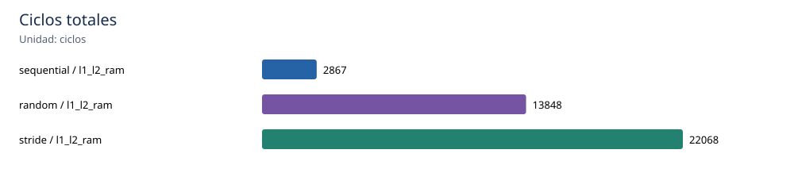
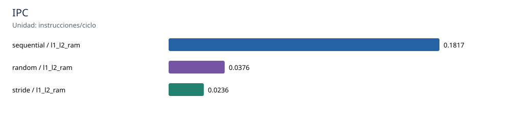
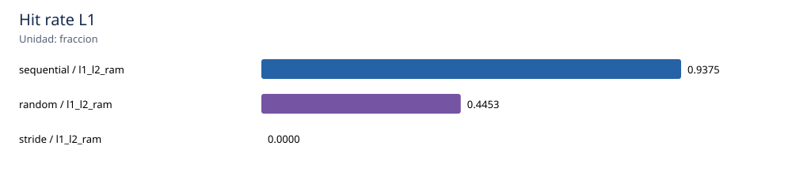
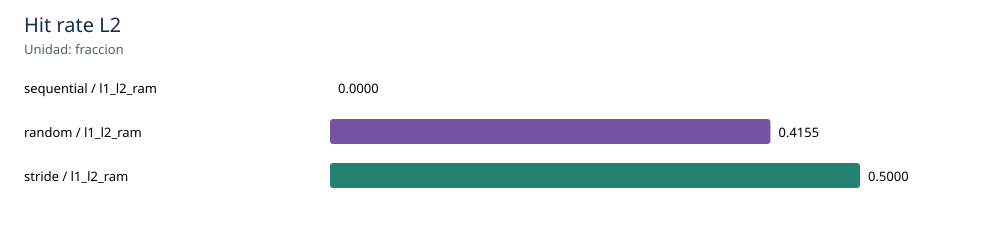
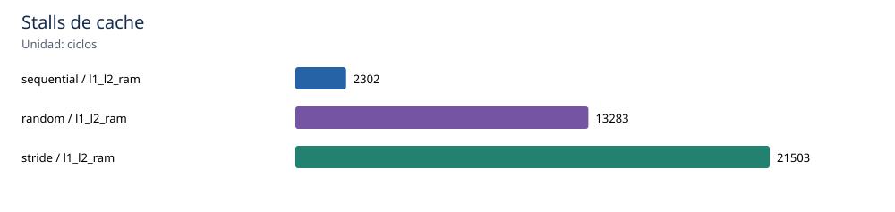
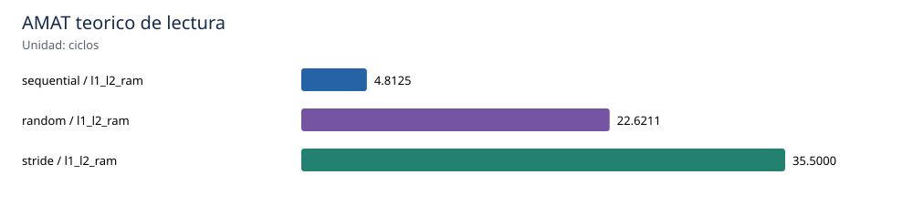

# Medicion del rendimiento

## Metodologia

Se contemplan tres benchmarks de lectura con 512 accesos previstos cada uno, en dos pasadas sobre la misma secuencia. El patron secuencial usa direcciones contiguas, el aleatorio selecciona palabras con semilla fija y el stride usa un salto de 32 bytes. Todos utilizan los mismos datos iniciales y se verifica el estado final de los diez registros esperados. Esta verificacion no sustituye pruebas de escritura, reemplazo y coherencia de los modulos de cache.

## Ejecucion preliminar

Desde la raiz del repositorio, con Icarus Verilog, Make y Python 3 instalados:

```bash
bash scripts/run_benchmarks.sh
python3 python/analyze_performance.py --baseline build/benchmarks/resultados_lecturas.csv
```

Los resultados se guardan en `build/benchmarks/analysis/`. El script ejecuta la jerarquia actual L1, L2 y RAM. Su CSV resume pruebas funcionales y no sustituye la exportacion de contadores de hardware. Los ciclos de `tb_run` incluyen su criterio de fin; los bundles en ROM son un conteo estatico y no deben utilizarse como instrucciones retiradas. Esta corrida es una referencia funcional preliminar, no una comparacion entre configuraciones.

## Contadores integrados

El modulo `performance_counters` cuenta en el reloj del procesador durante la ventana de medicion. El retiro debe producirse una sola vez por bundle valido en WB, contando los cuatro bits de actividad no-NOP, incluidos STORE, BRU y operaciones de seguridad sin escritura de registros. No se cuentan bundles invalidados por flush ni se repiten durante stall. La medicion debe incluir los ciclos de llenado y drenado del pipeline hasta completar la ultima instruccion real del programa, con un criterio identico en todas las configuraciones.

L1 se cuenta al clasificar la solicitud original antes del refill. Una lectura que causa miss no vuelve a contarse como hit cuando se entrega la linea. L2 reutiliza los cuatro contadores del controlador. Los accesos de L2 incluyen escrituras del write buffer, por lo que se separan lectura y escritura. La memoria cuenta solicitudes aceptadas y palabras realmente transferidas, sincronizadas al reloj de CPU. Las fases de stall deben excluirse entre si; el total de cache incluye espera por buffers y no se suma nuevamente a sus subcategorias. El contador de salto requiere un evento por ciclo perdido, no solo un pulso por salto tomado; se debe validar al integrar.

## Metricas

- IPC = instrucciones no-NOP completadas / ciclos totales.
- Hit rate = hits / (hits + misses), separado por nivel y por tipo de acceso. Miss rate = 1 - hit rate cuando existen accesos.
- Tmem = 25 + 7 * ceil(100 / frecuencia_memoria_MHz), en ciclos de CPU.
- AMAT teorico de lectura = 1 + miss_rate_L1_read * (8 + miss_rate_L2_read * Tmem). La tasa de L2 es local a las lecturas que llegan desde L1. Este modelo supone jerarquia completa, no incluye contencion ni espera por buffers y no equivale a una latencia medida por solicitud.
- Accesos a memoria = lecturas de lineas + escrituras de lineas. Ciclos nominales de transferencia = accesos * Tmem; se reportan tambien los ciclos de ocupacion observados, sin asumir que sean iguales.
- Ancho de banda observado = palabras transferidas * 4 bytes * 100 MHz / ciclos de CPU. Utilizacion = ancho de banda observado / (4 bytes * frecuencia de memoria), en porcentaje. La ventana de medicion debe ser comun a ambas cantidades.

## Contrato CSV para la integracion

El testbench definitivo debe exportar una fila por benchmark y configuracion, con `status=PASS` solo despues de validar la salida. Las columnas son:

```text
benchmark,configuration,status,memory_mhz,cycles,bundles,instructions,cache_stall_cycles,branch_stall_cycles,l2_lookup_stall_cycles,memory_stall_cycles,buffer_stall_cycles,l1_read_hits,l1_read_misses,l1_write_hits,l1_write_misses,l2_read_hits,l2_read_misses,l2_write_hits,l2_write_misses,mem_reads,mem_writes,mem_busy_cycles,mem_words
```

Los contadores deben provenir del hardware, no de las direcciones previstas por el generador. Para una configuracion sin cache se debe usar un reporte separado y medir el IPC real con los contadores del pipeline, sin aplicar el modelo AMAT de dos niveles. Para la jerarquia completa:

```bash
python3 python/analyze_performance.py --hardware build/benchmarks/hardware.csv --out build/benchmarks/analysis-hardware
```


## Resultados de las pruebas de integracion

Se verificaron los contadores utilizando programas pequenos
ejecutados en el procesador completo con L1, L2 y RAM.

### Comparacion de lecturas

| Prueba | Ciclos | Instrucciones | IPC | Hit rate L1 | AMAT teorico |
| --- | ---: | ---: | ---: | ---: | ---: |
| Una lectura | 77 | 2 | 0.0260 | 0% | 62.0 |
| Dos lecturas | 80 | 3 | 0.0375 | 50% | 31.5 |

En ambas pruebas se realizo una sola lectura fisica de RAM.
En la segunda, el LOAD adicional encontro su linea en L1.

Estos programas tienen diferente cantidad de instrucciones.
Por lo tanto, sus resultados sirven para demostrar la
reutilizacion de cache, pero no constituyen una comparacion
definitiva de velocidad entre configuraciones.

### Prueba de escritura

Se ejecuto un STORE seguido de un LOAD a la misma direccion.
El valor escrito fue recuperado correctamente.

Los contadores registraron:

- L1 write hits: 0
- L1 write misses: 1
- L2 write hits: 0
- L2 write misses: 1
- Lecturas fisicas de RAM: 1
- Escrituras fisicas de RAM: 0

El resultado es compatible con la politica write-back de L2.
Aun faltan pruebas adicionales de hits de escritura y desalojo
de lineas modificadas.

### Penalizaciones por saltos

Se realizaron tres pruebas:

| Caso | Penalizacion registrada | Resultado |
| --- | ---: | --- |
| JMP tomado desde EX | 3 ciclos | PASS |
| BNE no tomado | 0 ciclos | PASS |
| Redireccion del PC desde WB | 4 ciclos | PASS |

Los 3 y 4 ciclos proceden del modelo de recuperacion
implementado con las etapas invalidadas del pipeline.
Todavia falta contrastar esa estimacion con las burbujas
observadas independientemente en cada ejecucion.

### Regresiones

Pasaron correctamente:

- Compilacion completa de top.sv
- Pruebas de L1 y L2
- Pruebas aisladas de contadores y reset
- Integracion CPU, L1, L2 y RAM
- Pruebas basicas de saltos

Los resultados se exportaron a CSV y se analizaron
con python/analyze_performance.py, generando tablas
y graficas SVG.

### Validacion del programa matriz

Se ejecuto pruebas-compilador/matriz.mem sobre el procesador
completo con CPU, L1, L2 y RAM.

El programa contiene 4015 bundles y finaliza mediante un
salto JMP 0. Por eso se utilizo un testbench que detecta
ese salto en lugar de esperar 40 bundles NOP consecutivos.

Resultados obtenidos:

- Ciclos: 539896
- PC del salto final: 0x0000FAD0
- Matriz: 10x10
- resultado[0][0]: 21
- Indicador errores: 0
- Indicador prueba_correcta: 1
- Validacion de los elementos de las matrices: PASS

La verificacion consulta los valores visibles en la
jerarquia L1/L2/RAM, considerando las escrituras que
todavia pueden permanecer en cache.

El resultado demuestra la ejecucion funcional del programa
matriz en la arquitectura integrada.

## Benchmarks con contadores de hardware

Se ejecutaron los patrones sequential, random y stride sobre el procesador completo con L1, L2 y RAM.

Cada programa realiza 512 LOAD, distribuidos en dos pasadas. Se verificaron los registros finales antes de aceptar los resultados.

| Benchmark | Ciclos | IPC | Hit L1 | Hit L2 | AMAT teorico |
| --- | ---: | ---: | ---: | ---: | ---: |
| sequential | 2867 | 0.1817 | 93.75% | 0.00% | 4.8125 |
| random | 13848 | 0.0376 | 44.53% | 41.55% | 22.6211 |
| stride | 22068 | 0.0236 | 0.00% | 50.00% | 35.5000 |

### Contadores de memoria

| Benchmark | Hits L1 | Misses L1 | Hits L2 | Misses L2 | Lecturas RAM | Palabras RAM |
| --- | ---: | ---: | ---: | ---: | ---: | ---: |
| sequential | 480 | 32 | 0 | 32 | 32 | 256 |
| random | 228 | 284 | 118 | 166 | 166 | 1328 |
| stride | 0 | 512 | 256 | 256 | 256 | 2048 |

### Interpretacion

El patron secuencial obtuvo el mayor IPC y la mayor tasa de hits en L1. El patron aleatorio genero mas fallos de cache, mientras que stride obtuvo un miss en L1 por cada lectura. Esto incremento los ciclos necesarios para completar la misma cantidad de instrucciones.

El AMAT reportado corresponde al modelo teorico de lectura. No representa una medicion directa de latencia por acceso.

Estas pruebas comparan patrones de acceso sobre la misma arquitectura. No constituyen una comparacion contra una configuracion sin cache.

### Reproduccion

```bash
bash scripts/run_hardware_benchmarks.sh
```

El script genera los programas, valida los registros, exporta los contadores y produce reportes y graficas SVG en build/benchmarks/analysis-hardware/.


## Comparaciones pendientes

Se debe repetir cada benchmark con memoria realista sin cache y con L1/L2, manteniendo los mismos datos, programa y criterio de medicion. Se compararan configuraciones de cache acordadas por el equipo y programas del compilador con diferentes optimizaciones, verificando que las salidas sean equivalentes. Ya se capturaron resultados de las pruebas pequenas. Faltan las comparaciones definitivas entre configuraciones y los benchmarks completos.
# Análisis de rendimiento y validación experimental

**Proyecto II — CE4301.** Las cifras corresponden a `docs/evidencias_rendimiento/hardware.csv` de la instantánea proporcionada. Los datos se procesaron de nuevo con `python/analyze_performance.py`, que aceptó las tres filas marcadas PASS. **No se ejecutó una simulación nueva de Icarus Verilog durante esta actualización documental.**

## 1. Objetivo y método

Se mide el efecto de la **localidad espacial y temporal** en la jerarquía `L1-D → L2 → RAM`. Los programas se producen mediante `python/generate_benchmarks.py` y se simulan con `tb/tb_benchmarks_hw.sv`, que conecta la CPU real, no un modelo estadístico. El script `scripts/run_hardware_benchmarks.sh` realiza generación, compilación, simulación, comprobación de registros y exportación a CSV. El programa debe finalizar según el criterio de **40 bundles NOP consecutivos** del testbench; los programas especiales con salto final utilizan otro criterio.

Cada benchmark ejecuta **512 LOAD** (256 accesos repetidos una segunda vez), con **521 instrucciones no-NOP retiradas** según el CSV, y una ventana de medición comparable. Los valores de datos son deterministas y el generador usa una semilla fija para el patrón aleatorio.

| Patrón | Secuencia de direcciones |
| --- | --- |
| `sequential` | Palabras contiguas, dos pasadas para observar reuso en L1. |
| `random` | Muestra seudoaleatoria fija entre 2048 palabras de datos, repetida. |
| `stride` | Direcciones separadas por 32 bytes, una línea de caché por acceso, dos pasadas. |

**Configuración:** CPU 100 MHz, RAM 25 MHz, L1 4 KiB/2 vías y L2 16 KiB/4 vías. El CSV denomina a esta única configuración `l1_l2_ram`.

## 2. Qué miden los contadores

`src/performance_counters.sv` cuenta ciclos CPU durante `measure_i`, bundles completados en WB, instrucciones no-NOP, stalls de caché y salto, hits/misses de lectura y escritura en L1, accesos físicos a RAM, tiempo ocupado y palabras transferidas. Los hits/misses de L2 provienen de `l2_controller.sv` y `top.sv` los expone como puertos de 64 bits.

Los eventos de L1 se contabilizan para la operación original, antes de refill. En L2 se distinguen READ y WRITE para no mezclar escrituras de FIFO con fallos de lectura. Los subcontadores de stall (`l2_lookup`, `memory`, `buffer`) explican parte del total de stalls; **no se suman al total porque son subconjuntos**. Los ciclos de llenado/drenado y el criterio de terminación afectan el IPC, por lo que deben mantenerse iguales entre comparaciones.

## 3. Fórmulas

Con todos los conteos de una misma ventana:

- `IPC = instrucciones_retiradas / ciclos_totales`.
- `Hit rate L1 read = l1_read_hits / (l1_read_hits + l1_read_misses)`.
- `Hit rate L2 read = l2_read_hits / (l2_read_hits + l2_read_misses)`; es la tasa **local de las solicitudes que llegan a L2**, no sobre todos los LOAD de la CPU.
- `Miss rate = 1 − Hit rate`, cuando existe al menos un acceso.
- `Tmem_teórico = 25 + 7 × ceil(100 MHz / f_mem)` ciclos CPU, según el enunciado.
- `AMAT_teórico_read = 1 + MR_L1_read × (8 + MR_L2_read × Tmem_teórico)`.
- `Ancho_de_banda_observado = palabras_RAM × 4 bytes × 100 MHz / ciclos_CPU`.
- `Utilización = palabras_RAM / (ciclos_CPU × f_mem/100 MHz)`, presentada como porcentaje.

El AMAT usa la penalidad nominal **53 ciclos CPU** para f_mem=25 MHz y **no mide directamente** el tiempo de cada LOAD, ni incluye esperas por conflictos o buffers. El RTL usa `MEM_FIRST_LAT=3` en ciclos del reloj de memoria y tiempos adicionales de handshake/CDC: es necesario comprobar de forma separada la latencia hasta la primera palabra.

## 4. Resultados reproducidos desde el CSV

| Métrica | Sequential | Random | Stride |
| --- | ---: | ---: | ---: |
| Ciclos totales | 2 867 | 13 848 | 22 068 |
| Bundles retirados | 560 | 560 | 560 |
| Instrucciones no-NOP | 521 | 521 | 521 |
| IPC | 0.1817 | 0.0376 | 0.0236 |
| Ciclos stall caché | 2 302 | 13 283 | 21 503 |
| Hits L1 de lectura | 480 | 228 | 0 |
| Misses L1 de lectura | 32 | 284 | 512 |
| Hit rate L1 (read) | 93.75 % | 44.53 % | 0.00 % |
| Hits L2 de lectura | 0 | 118 | 256 |
| Misses L2 de lectura | 32 | 166 | 256 |
| Hit rate L2 (read) | 0.00 % | 41.55 % | 50.00 % |
| Solicitudes read a RAM | 32 | 166 | 256 |
| Palabras transferidas por RAM | 256 | 1 328 | 2 048 |
| AMAT teórico de lectura (ciclos) | 4.8125 | 22.6211 | 35.5000 |

Los tres casos tienen **0 accesos de STORE en este conjunto concreto**; por lo tanto, este CSV no mide las tasas de escritura ni el costo del write-back en los desalojos. Esas propiedades deben comprobarse con testbenches de escritura, reemplazo y conflicto RAW.

## 5. Gráficos disponibles

Los siguientes SVG ya están almacenados en el repositorio y son visualizables en GitHub:

| Ciclos totales | IPC |
| --- | --- |
|  |  |

| Tasa hit L1 | Tasa hit L2 |
| --- | --- |
|  |  |

| Stalls caché | AMAT teórico (lectura) |
| --- | --- |
|  |  |

Los SVG son **evidencias previamente generadas**, no se vuelven a dibujar con datos inventados. En GitHub se muestra la versión de esos archivos que esté en `main`.

## 6. Análisis

**Sequential.** De los 512 LOAD, 480 se resolvieron en L1; las 32 líneas distintas generaron 32 misses hacia L2 y RAM, y luego se reutilizaron en la segunda pasada. Se obtuvo el IPC más alto (0.1817) y la menor cantidad de stalls de caché.

**Random.** Con baja localidad espacial, 284 solicitudes fallaron en L1; de estas, 118 fueron resueltas en L2 y 166 llegaron a RAM. El tráfico adicional explica el aumento de 2 867 a 13 848 ciclos respecto de sequential, con el mismo número de instrucciones retiradas.

**Stride.** Cada acceso avanza una línea completa de 32 bytes, de modo que L1 no reportó hits en este conjunto de trabajo. L2 atendió 256 de los 512 misses de L1, mientras que los restantes 256 necesitaron RAM. Este patrón presentó el mayor costo en ciclos (22 068) y el menor IPC (0.0236).

**Interpretación de L2 en sequential:** que L2 tenga 0 % de hits no indica necesariamente ineficiencia: L1 retuvo las líneas reutilizadas, de modo que L2 recibió principalmente misses fríos. Las tasas de diferentes niveles tienen denominadores distintos.

**Alcance de la conclusión:** estas mediciones muestran diferencias entre **patrones de acceso con la misma jerarquía**. No bastan para atribuir una mejora porcentual a la caché frente a una RAM sin caché, ni para cuantificar los beneficios de loop unrolling, DCE, reordenamiento o spilling.

## 7. Programa de integración del compilador

La prueba `tb/tb_matriz.sv` utiliza `pruebas-compilador/matriz.mem` y detecta el salto final del programa. La versión previamente documentada en este repositorio reporta **539 896 ciclos**, matriz de **10×10**, `resultado[0][0]=21`, indicador `prueba_correcta=1` y `errores=0`. Estos valores están anotados en la documentación del avance y deben conservarse como **resultado reportado**, sujeto a revalidación ejecutando el testbench contra el mismo archivo `.mem`. La comprobación del testbench lee datos visibles en L1, L2 o RAM para no interpretar una escritura write-back pendiente como pérdida de datos.

## 8. Reproducción

Desde la raíz:

```bash
bash scripts/run_hardware_benchmarks.sh
# El script deja las nuevas cifras en build/benchmarks/hardware.csv

python3 python/analyze_performance.py \
  --hardware docs/evidencias_rendimiento/hardware.csv \
  --out build/analisis-evidencia
```

Las validaciones funcionales que dan lugar a `status=PASS` ocurren en `generate_benchmarks.py --check-log`; el analizador exige columnas válidas y valores consistentes y recalcula métricas. **No sustituye la comprobación funcional de los datos por sí mismo.**

## 9. Comparaciones y pruebas aún pendientes

1. Ejecutar los mismos programas sobre una configuración sin caché (o baseline de memoria realista) y comparar ciclos, IPC y stalls con condiciones idénticas.
2. Medir la latencia de primera palabra desde la solicitud para contrastarla con el requisito de 25 ciclos CPU, más burst completo.
3. Validar y registrar resultados de benchmarks con STORE, desalojos dirty y saturación de buffers.
4. Medir variantes de cache/reemplazo si van a presentarse como comparadas experimentalmente.
5. Compilar versiones equivalentes de benchmarks con y sin optimizaciones de CE1108 y medirlas sobre esta CPU, manteniendo igual salida.
6. Capturar logs de regresión y el hash de commit final que respalde las gráficas y tablas.
